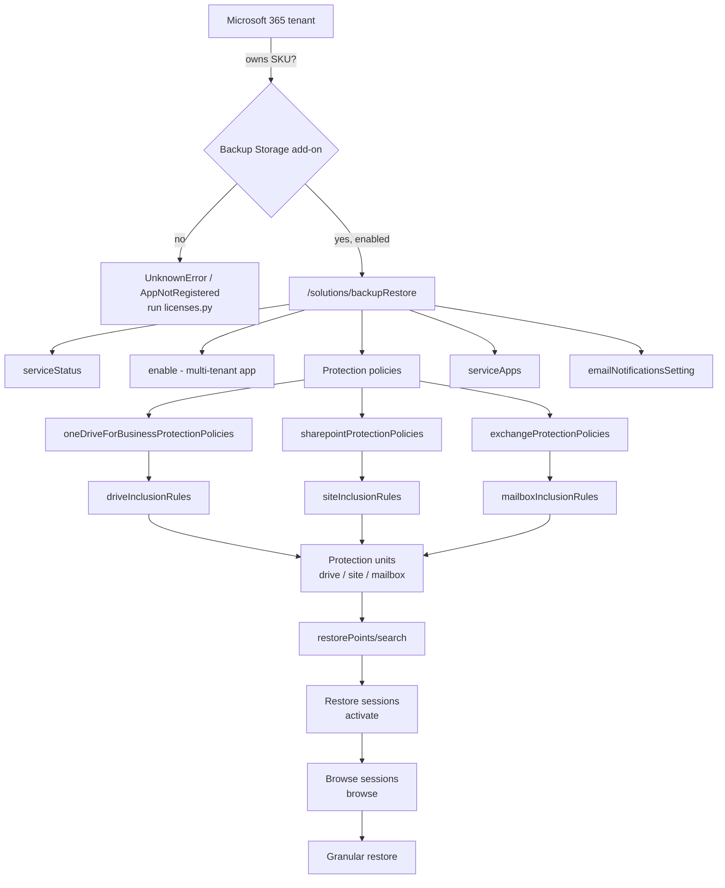

# Microsoft 365 Backup Storage

Manage the Microsoft 365 Backup Storage service via Graph: check whether the
tenant is entitled to it, enable it, define protection policies and units, and
drive point-in-time restores through restore points, restore sessions and browse
sessions.

---

## Licensing: read this first

Microsoft 365 Backup Storage is a **paid add-on**. Being granted the
`BackupRestore-Control.*` permissions (application or delegated) is **not**
enough — the tenant must also own the Backup Storage SKU. On a tenant without the
add-on every `backupRestore` call fails, and the familiar symptoms are:

| Symptom | What it really means |
|---|---|
| `AccessDeniedException` / `('UnknownError', '')` | No Backup Storage entitlement on the tenant |
| `AppNotRegistered` (delegated) | The Backup Storage service app is not registered for the tenant yet |
| `ServiceAppNotFound` | Same as above, from the `serviceApps` endpoint |

The first question to answer is therefore *"is my tenant licensed?"*. Run:

```bash
python examples/backuprestore/licenses.py
```

It lists every subscribed SKU and highlights one that matches `backup`; on a
typical developer tenant (e.g. `DEVELOPERPACK_E5`, `FLOW_FREE`) there is no
match, and no amount of permission tweaking will make the API work.

If the SKU is present but the service is still disabled, **enable** it. The
`enable` operation is special: it must be invoked by a **multi-tenant app
registered in another tenant** that owns the Backup Storage permission, passing
that tenant's id. See
[`enable_service.py`](./enable_service.py) (`--app-owner-tenant-id`, `--apply`).

> **Every example in this folder degrades gracefully.** When the service is not
> licensed/registered the script prints a one-line explanation and exits with
> code `0` instead of raising — so the folder stays runnable on any tenant.

---

## How it works

The service is gated by the tenant entitlement, then everything hangs off the
`backupRestore` root:



A typical workflow is: **license → enable → policy (+ rule) → protected unit →
search restore points → create/activate a restore session → browse the point →
restore**.

---

## Prerequisites

| Requirement | Description |
|---|---|
| `BackupRestore-Control.Read.All` | Read service status, policies, units, restore points/sessions |
| `BackupRestore-Control.ReadWrite.All` | Enable the service, offboard units, activate sessions, edit notifications |
| **Microsoft 365 Backup Storage license** | Paid add-on; without it `backupRestore` is unavailable |
| **Multi-tenant app in another tenant** | Required only for the `enable` operation |
| `Organization.Read.All` / `Directory.Read.All` | Read subscribed SKUs (used by [`licenses.py`](./licenses.py)) |

---

## Examples

| Scenario | File | Write? |
|---|---|---|
| **Check whether the tenant is licensed** | [`licenses.py`](./licenses.py) | no |
| Read the service status (consumer, grace period, disable reason) | [`service_status.py`](./service_status.py) | no |
| Enable the service for the tenant | [`enable_service.py`](./enable_service.py) | yes (`--apply`) |
| List policies + inclusion rules for all three workloads | [`protection_policies.py`](./protection_policies.py) | no |
| List protection units and offboard / cancel offboard one | [`protection_units.py`](./protection_units.py) | yes (`--apply`) |
| Search restore points in a time window | [`restore_points.py`](./restore_points.py) | no |
| List restore sessions and activate one | [`restore_sessions.py`](./restore_sessions.py) | yes (`--apply`) |
| List browse sessions and browse their contents | [`browse_sessions.py`](./browse_sessions.py) | yes (`--apply`) |
| List service apps and activate / deactivate one | [`service_apps.py`](./service_apps.py) | yes (`--apply`) |
| Read/update the email-notification setting | [`email_notifications.py`](./email_notifications.py) | yes (`--apply`) |

Every write example defaults to a **dry run**; add `--apply` to submit the call.

---

## Quick start

```python
from office365.graph_client import GraphClient

client = GraphClient(tenant="contoso.onmicrosoft.com").with_client_secret("client_id", "client_secret")

backup = client.solutions.backup_restore
backup.get().execute_query()  # raises until the tenant is licensed
print(f"Backup service status: {backup.service_status.status}")
```

---

## Advanced: protection-rule lifecycle

Rules can be executed on demand (`run`) or removed together with their
protected data (`deleteAndUnprotect`); both actions return the updated rule:

```python
rule = client.solutions.backup_restore.one_drive_for_business_protection_policies["policy-id"].drive_inclusion_rules[
    "rule-id"
]

rule.run().execute_query()
rule.delete_and_unprotect().execute_query()
```

---

## Official docs

- [Microsoft 365 Backup Storage overview](https://learn.microsoft.com/en-us/graph/api/resources/backuprestore-overview)
- [backupRestoreRoot resource](https://learn.microsoft.com/en-us/graph/api/resources/backuprestoreroot)
