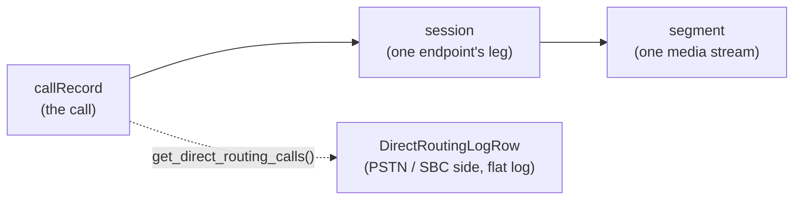

# Working with call records

Call records are the raw material of Teams call-quality and telephony
reporting: one record per call, with the sessions, media segments and endpoints
that were involved. They come from the **application** context only — there is
no "my calls" version — and are retained for 30 days.

Requires the application permission `CallRecords.Read.All` (client credentials).

## The model



A call with four participants has (at least) four sessions; each session has one
segment per media type (audio, video, screen share). Quality metrics and
timings live on the **segment**, which is why reports walk the whole tree.

## List records

```python
feed = client.communications.call_records.filter("startDateTime ge 2026-01-01T00:00:00Z")
records = list(feed.get().execute_query())[:20]
```

→ [`list.py`](./list.py)

The feed rejects `$top`, so the page is fetched and truncated client-side;
`startDateTime` is the one useful filter and keeps the query cheap.

## Walk a call

```python
for session in record.sessions.get().execute_query():  # 2nd level
    for segment in session.segments.get().execute_query():  # 3rd level
        ...
```

→ [`sessions.py`](./sessions.py)

## Direct Routing (PSTN)

```python
rows = (
    client.communications.call_records.get_direct_routing_calls(from_datetime=week_ago, to_datetime=now)
    .execute_query()
    .value
)
```

→ [`direct_routing.py`](./direct_routing.py)

This one is not an entity collection: the rows are `DirectRoutingLogRow`
**values** inside a `ClientResult`, so read `.value` before iterating.

## Gotchas

| Symptom | Cause |
| --- | --- |
| empty feed | call records need an actual Teams call in the last 30 days |
| `$top` rejected | the callRecords feed has no `$top` support — page and slice |
| `403` with delegated auth | call records are application-only |
| `getDirectRoutingCalls` returns nothing | no call left the tenant through an SBC |
