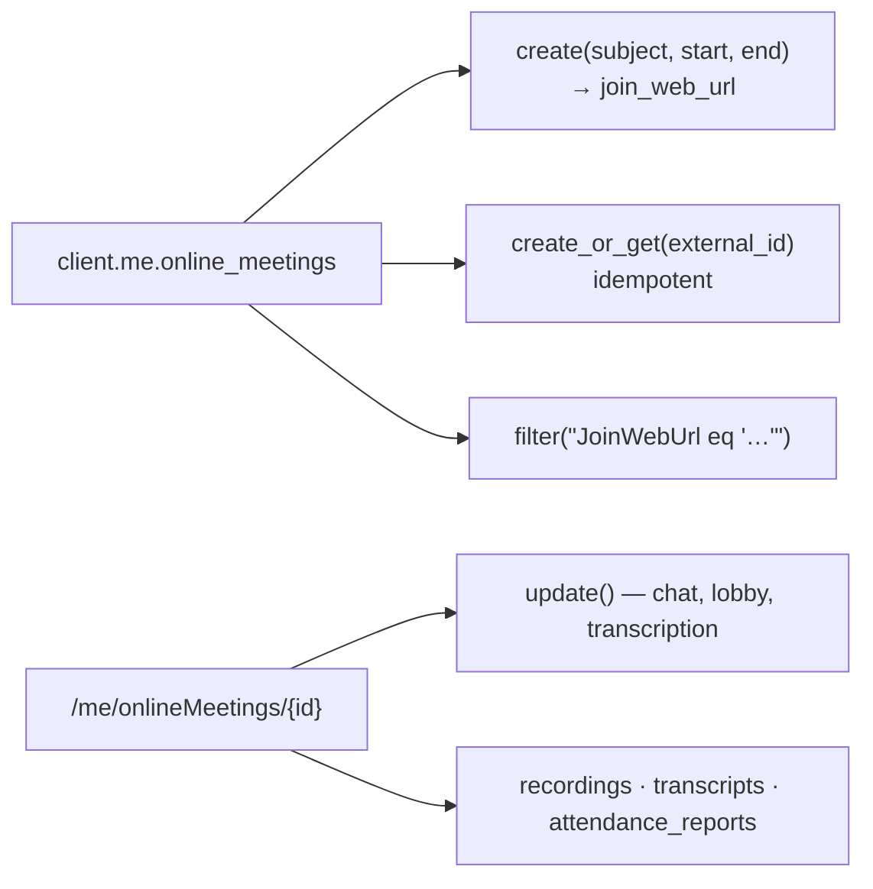

# Working with online meetings

An **online meeting** is the Teams object behind a join link. It is *not* a
calendar event: creating one returns a `joinWebUrl` (and an id) and puts nothing
on anyone's calendar. To send an invite, post the link as an event body — see
[`../../outlook/events/online_meeting.py`](../../outlook/events/online_meeting.py).

Requires the delegated permission `OnlineMeetings.ReadWrite`. The scripts create
throwaway meetings and delete them at the end, so they are safe to re-run.

## The model



## Create

```python
meeting = client.me.online_meetings.create(
    subject="Project sync",
    start_datetime=start,
    end_datetime=end,
    lobbyBypassSettings={"isDialInBypassEnabled": True, "scope": "organization"},
).execute_query()
print(meeting.join_web_url)
```

→ [`create.py`](./create.py)

## Create once, even if you call twice

`createOrGet` keys the meeting on **your** `externalId`: call it again and you
get the same meeting back. That makes retries and two concurrent booking workers
safe.

```python
meeting = client.me.online_meetings.create_or_get(
    external_id=booking_id,
    subject="Customer demo",
    start_datetime=start,
    end_datetime=end,
).execute_query()
```

→ [`create_or_get.py`](./create_or_get.py)

## Find a meeting again

There is no "list my online meetings": `/me/onlineMeetings` without a filter
answers *InvalidArgument*, and the only supported filter is `JoinWebUrl`. Keep
the id from creation, or resolve the link from the invite back to the meeting.

```python
client.me.online_meetings[meeting_id].get().execute_query()
client.me.online_meetings.filter(f"JoinWebUrl eq '{join_url}'").get().execute_query()
```

→ [`lookup.py`](./lookup.py)

## Change options

The conference-settings properties (`allowMeetingChat`, `allowTranscription`,
`lobbyBypassSettings`, …) have **no Python setters** — write them with
`set_property` and PATCH:

```python
meeting.set_property("allowMeetingChat", "disabled")
meeting.set_property("allowTranscription", True)
meeting.update().execute_query()
```

→ [`update.py`](./update.py) · delete with [`delete.py`](./delete.py)

## Artifacts

Recordings, transcripts and attendance reports hang off the meeting, and each
has its own scope. [`artifacts.py`](./artifacts.py) reports what your tenant
actually allows instead of failing, so you can see which consent is missing.

## Gotchas

| Symptom | Cause |
| --- | --- |
| `InvalidArgument: … to lookup meeting by QueryOptions is null` | listing needs `$filter=JoinWebUrl eq '…'` |
| `AttributeError: can't set attribute` | the property is read-only in the client: use `set_property(...)` + `update()` |
| `lobbyBypassSettings.scope` comes back `unknownFutureValue` | the lobby object was sent partially (include `isDialInBypassEnabled`) or batched with other properties |
| recording/transcript/attendance `403` | the artifact scope is not consented, or the meeting has not ended |
| `Forbidden` on `getAllRecordings` | not supported on all tenants; read `meeting.recordings` instead |
