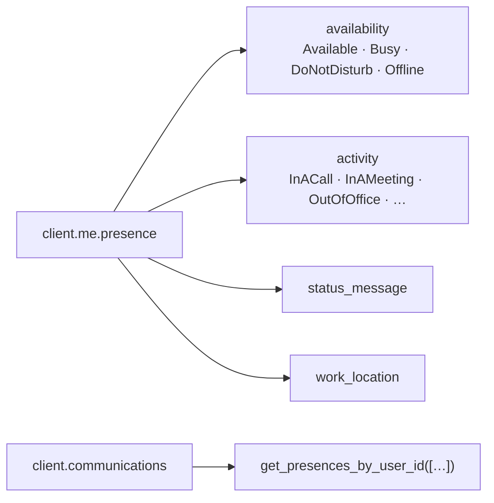

# Working with presence

Presence answers one question: *is this person reachable right now?* It is a
per-user resource (`/users/{id}/presence`) that Teams keeps current, driven by
the user's activity (`InACall`, `InAMeeting`, …). The scripts here read it in
bulk, override it for yourself, and poll it for changes — using throwaway state
that expires on its own.

Permissions: `Presence.Read` (your own), `Presence.Read.All` (anyone),
`Presence.ReadWrite` (change your own).

## The model



`availability` is the coarse state; `activity` refines it. A status message and a
work location ride along on the same resource.

## Read one user

```python
presence = client.me.presence.get().execute_query()
print(presence.availability, presence.activity)
```

→ [`get.py`](./get.py) — pass `--user ana@contoso.com` to read a colleague's
presence with `client.users[upn].presence`.

## Read many users at once

One request per 650 users instead of one per user — the right shape for a
people-picker or a "who's available" dashboard.

```python
for presence in client.communications.get_presences_by_user_id(upns).execute_query():
    print(presence.id, presence.availability, presence.activity)
```

→ [`bulk_get.py`](./bulk_get.py)

## Set your own presence

```python
client.me.presence.set_user_preferred_presence("DoNotDisturb", "DoNotDisturb", "PT2H").execute_query()
client.me.presence.set_status_message("In a meeting", expiry).execute_query()
```

→ [`set.py`](./set.py) · the counterpart is [`clear.py`](./clear.py)

Two things to know:

1. **It only shows while the user has a presence session** — i.e. while Teams
   (or an app) is signed in. With no session, the API keeps reporting `Offline`
   no matter what you set. A *preferred* presence is not a fake presence.
2. `expiration_duration` is a fixed window (5–240 minutes); when it lapses, the
   presence reverts to automatic. Clearing ends it immediately. There is no
   `clearStatusMessage` action in this API version, so an empty message is the
   way to wipe a status message.

An application can also publish presence for its own sessions — for example a
softphone — with `client.communications.presences[user_id].set_presence(session_id, …)`.

## Watch for changes

Presence has no change notifications: no webhooks, no delta. Monitoring means
polling, and the pattern is bulk-read, remember the previous state, report only
transitions. The same file shows the business rules — who is reachable, and how
to drive an agent on/off duty.

→ [`monitor.py`](./monitor.py)

## Troubleshooting

| Symptom | Cause |
| --- | --- |
| everyone is `PresenceUnknown` | the caller lacks `Presence.Read.All`, or no user session exists |
| set succeeded but presence is `Offline` | the user has no presence session (Teams closed) |
| `403` when reading someone else | the app only has `Presence.Read` (own presence) |
| set-time `400` | `expirationDuration` outside `PT5M`–`PT4H` |
| `InvalidArgument: The provided availability/activity is invalid` | the activity must match the availability (`Available/Available`, `Away/Away`, `DoNotDisturb/DoNotDisturb`, `Offline/OffWork`) — you cannot fake `InAMeeting` |
| `Cannot set the presence of another user` | delegated `setUserPreferredPresence` only works on `/me/presence` |
