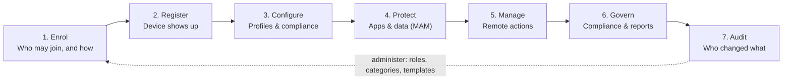
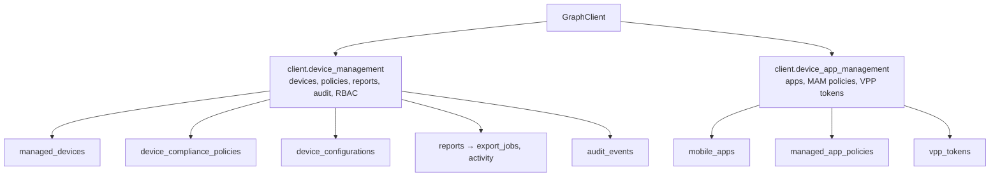

# Microsoft Intune

Intune is Microsoft's **device and app management** service. Through the Graph
API you can inventory devices, push configuration and compliance policy,
protect app data, run remote actions, and audit everything an administrator
does. This folder is a guided tour: start with the lifecycle, then open the
stage you care about.

> **This is not "yet another API list".** Every script runs against a real
> tenant, explains *what* it does and *why* you would use it, and — when a
> permission has not been consented or the tenant has no data — prints the
> missing scope and exits `0` instead of failing.

---

## How Intune works — the lifecycle

Intune is easiest to reason about as a pipeline. A device moves through these
stages, and each stage has its own folder here:



| Stage | Question it answers | Folder |
|---|---|---|
| **1. Enrol** | Who and what may enrol, and how? | [`enrollment/`](./enrollment/README.md) |
| **2. Register** | Which devices does Intune now manage? | [`devices/`](./devices/README.md) |
| **3. Configure** | What settings and compliance rules apply? | [`policies/`](./policies/README.md) |
| **4. Protect** | Which apps may access corporate data? | [`apps/`](./apps/README.md) |
| **5. Manage** | What can I do to a device right now? | [`devices/`](./devices/README.md) |
| **6. Govern** | Is the fleet healthy? Why did enrolment fail? | [`reports/`](./reports/README.md) |
| **7. Audit** | Who changed what, and when? | [`audit/`](./audit/README.md) |
| **Administer** | Who is allowed to do all of the above? | [`administration/`](./administration/README.md) |

### The object model

Everything hangs off **two** singletons on the client. Knowing which one to use
is half the battle:



There is no top-level `client.intune`; `device_management` *is* the Intune
namespace, and app-facing resources live under `device_app_management`.

---

## Start here

| # | Script | What you get |
|---|---|---|
| 0 | [`quickstart.py`](./quickstart.py) | Connect, count devices, read the enrolment overview |
| 1 | [`lifecycle.py`](./lifecycle.py) | Walk **all seven stages** against your tenant in one run |

```bash
python quickstart.py
python lifecycle.py
```

---

## Authentication — read this first

Intune needs an **Intune role** as well as a Graph permission, and there is a
real difference between auth modes:

- **Application (client secret / certificate)** — what a background service
  should use, but the app registration must be granted the `DeviceManagement*`
  **application** roles *and* an Intune admin must assign it a role. On the demo
  tenant used to build these examples the app-only token has **no** Intune
  roles, so every call is `403`.
- **Delegated (username + password / interactive)** — signs in *as a person*.
  It is the only mode that works out of the box on the demo tenant, so the
  examples use delegated ROPC:

  ```python
  from office365.graph_client import GraphClient

  client = GraphClient(tenant=tenant).with_username_and_password(client_id, username, password)
  ```

  Use `with_client_secret(...)` / `with_certificate(...)` in production and
  grant the corresponding **application** permissions; the resource paths in
  every script are identical.

| Permission | Lets you read/write | Used by |
|---|---|---|
| `DeviceManagementManagedDevices.Read.All` | Devices, overview, detected apps | `quickstart`, `devices/`, `lifecycle` |
| `DeviceManagementManagedDevices.ReadWrite.All` | Above + update device properties | `devices/primary_user` |
| `DeviceManagementManagedDevices.PrivilegedOperations.All` | Remote actions, primary user changes | `devices/remote_actions`, `devices/primary_user` |
| `DeviceManagementConfiguration.Read.All` | Compliance policies, configuration profiles | `policies/`, `devices/compliance` |
| `DeviceManagementApps.Read.All` | Mobile apps, MAM policies, VPP tokens, audit events | `apps/`, `audit/` |
| `DeviceManagementServiceConfig.Read.All` | Enrolment config, Autopilot, categories, templates | `enrollment/`, `administration/`, `protection/` |
| `DeviceManagementRBAC.Read.All` | Role definitions and assignments | `administration/roles.py` |

Admin consent is required. The [Graph permissions
reference](https://learn.microsoft.com/en-us/graph/permissions-reference#device-management-permissions)
lists the application/delegated split for each.

---

## A note on an empty (or restricted) tenant

The demo tenant has **zero** managed devices and only a subset of the Intune
scopes consented. The examples are written for that reality:

- lists render `(0)` or "No managed devices matched" — not an error;
- a `403` prints `[skipped] <code>: <the exact missing scope>` and exits `0`;
- `reports/export_jobs.py` polls a genuine long-running operation and reports
  "still running" cleanly when it hits the `--timeout`.

If you want data to look at, enrol one device (or run the examples against a
production tenant) and they light up without any change.

---

## Running the examples

```bash
# from the repository root, with the project's virtualenv
.venv/bin/python examples/intune/quickstart.py
.venv/bin/python examples/intune/devices/inventory.py --compliance noncompliant
.venv/bin/python examples/intune/reports/export_jobs.py --report Devices
```

Credentials come from `tests/settings` (`client_id`, `tenant`, `username`,
`password`). Anything that writes a file writes to the **system temp directory**
unless you pass an explicit path, so nothing is left in the repository.

---

## Official docs

- [What is Microsoft Intune?](https://learn.microsoft.com/en-us/mem/intune/fundamentals/what-is-intune)
- [Intune Graph API overview](https://learn.microsoft.com/en-us/graph/api/resources/intune-graph-overview)
- [Intune permissions](https://learn.microsoft.com/en-us/graph/permissions-reference#device-management-permissions)
