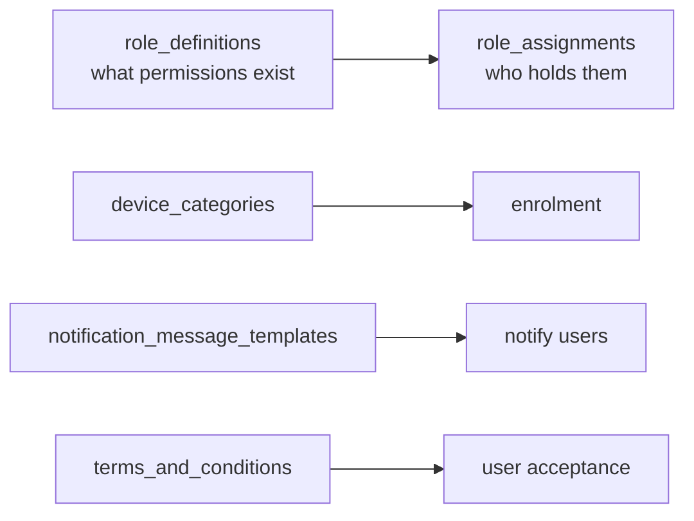

# Administration

The **administer** layer: who is allowed to operate Intune, and the small
datasets that support the other stages.

- **Intune RBAC** — role *definitions* (named permission sets) and role
  *assignments* (a definition bound to a group within a scope tag). This is
  separate from Entra ID directory roles.
- **Device categories** — admin-defined buckets (e.g. "Kiosk") users can pick
  during enrolment.
- **Notification templates** — branded emails Intune sends.
- **Terms and conditions** — agreements users accept before device access.



## Start here

```bash
python roles.py --assignments --effective
python categories.py --templates --terms
```

| Script | What / why | Permissions |
|---|---|---|
| [`roles.py`](./roles.py) | Role definitions (built-in vs custom, permission-set count); `--assignments` shows who holds each role, `--effective` shows the caller's effective permissions. | `DeviceManagementRBAC.Read.All` |
| [`categories.py`](./categories.py) | Device categories; `--templates` adds notification templates, `--terms` adds terms and conditions with acceptance counts. | `DeviceManagementServiceConfig.Read.All` |

## Reading RBAC

`role.py --effective` calls `device_management.get_effective_permissions()` and
prints the caller's allowed resource actions — the fastest way to answer "can
this account wipe a device?". A role definition's `is_built_in` flag tells you
whether it is one of Microsoft's defaults or a custom role.

## Official docs

- [List role definitions](https://learn.microsoft.com/en-us/graph/api/intune-rbac-devicemanagement-list-roledefinitions)
- [List role assignments](https://learn.microsoft.com/en-us/graph/api/intune-rbac-devicemanagement-list-roleassignments)
- [Intune RBAC](https://learn.microsoft.com/en-us/mem/intune/fundamentals/role-based-access-control)
- [List device categories](https://learn.microsoft.com/en-us/graph/api/intune-devices-devicecategory-list)
