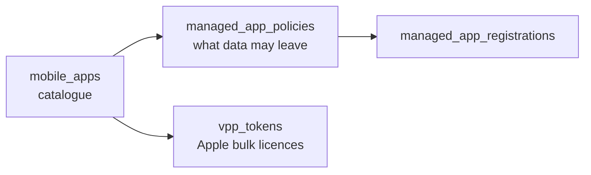

# Apps & protection

The **protect** stage. Intune can manage the *app* without managing the whole
device, which is what makes "bring your own device" practical. Three datasets
live here:

- **`mobile_apps`** — the app catalogue (store, managed store, Win32/LOB, web).
- **`managed_app_policies`** — MAM/data-loss rules (block copy/paste, require a
  PIN, selective wipe) and the app registrations they cover.
- **`vpp_tokens`** — Apple volume-purchase licensing and its sync/expiry health.



## Start here

```bash
python inventory.py --details
python app_protection.py --details
python licensing.py
```

| Script | What / why | Permissions |
|---|---|---|
| [`inventory.py`](./inventory.py) | The app catalogue with categories; `--details` adds each app's categories and assignment count. | `DeviceManagementApps.Read.All` |
| [`app_protection.py`](./app_protection.py) | MAM policies plus managed app registrations — who is protected, by what. | `DeviceManagementApps.Read.All` |
| [`licensing.py`](./licensing.py) | VPP tokens flagged `[STALE]` (no sync in 7 days) and `[EXPIRING]` (within 30 days). | `DeviceManagementApps.Read.All` |

## MAM vs MDM

- **MDM** (the rest of this folder) manages the *device*; compliance is about the
  whole machine.
- **MAM** (this folder) manages the *app*; a personal phone can have a managed
  Outlook with corporate data fenced off from personal apps.
  `managed_app_registrations` is the per-user record of which apps are under
  management.

## Official docs

- [List mobile apps](https://learn.microsoft.com/en-us/graph/api/intune-apps-mobileapp-list)
- [List app protection policies](https://learn.microsoft.com/en-us/graph/api/intune-mam-managedapppolicy-list)
- [List VPP tokens](https://learn.microsoft.com/en-us/graph/api/intune-apps-vpptokens-list)
