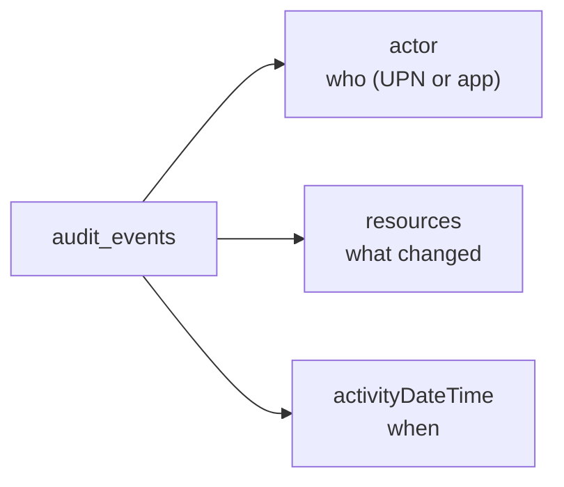

# Audit

The **audit** stage: a tamper-evident trail of every administrative change in
Intune. Each event names an actor, the activity, the resources it touched and
the result — the first stop for "why did this setting change?".



## Start here

```bash
python events.py --days 7
python events.py --days 30 --category DeviceConfiguration --details
```

| Script | What / why | Permissions |
|---|---|---|
| [`events.py`](./events.py) | Browse the audit trail for the last N days, filter by category, and optionally list the affected resources. | `DeviceManagementApps.Read.All` or an Intune admin role |

## Reading an event

- `activity` is the verb (`Update deviceConfiguration`, `Wipe`), `activityResult`
  is `success`/`failure`.
- `actor` is an `AuditActor`; use `userPrincipalName` for a person or
  `applicationDisplayName` for an app/automation.
- `resources` is a collection of `AuditResource`, each with a type, display name
  and the properties that were modified.

> The `AuditActor`/`AuditResource` models use the raw OData attribute names
> (`userPrincipalName`, `displayName`). Access them directly on the object, as
> the script does.

## Official docs

- [List audit events](https://learn.microsoft.com/en-us/graph/api/intune-auditing-auditevent-list)
- [Intune audit logs](https://learn.microsoft.com/en-us/mem/intune/fundamentals/monitor-audit-logs)
