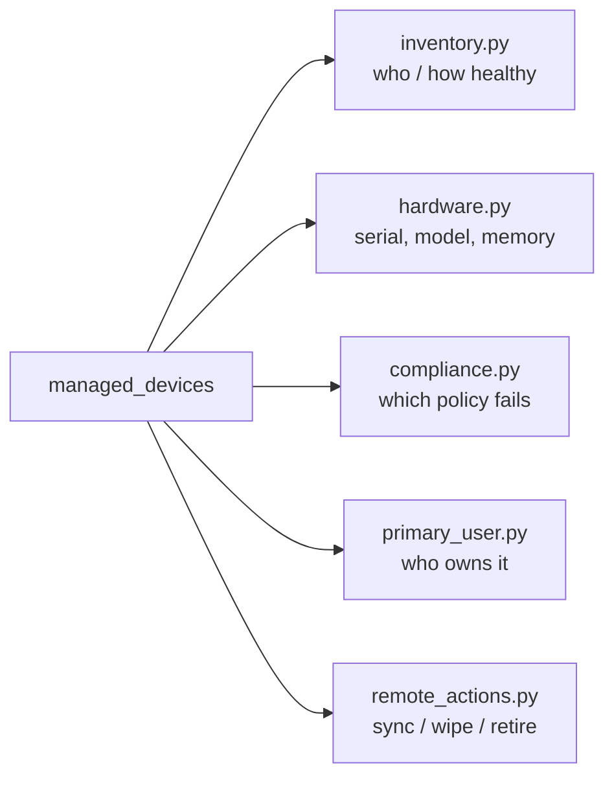

# Devices

The **registered** stage of the lifecycle: devices that Intune now manages.
This is where most day-to-day work happens — inventory, hardware detail,
compliance lookup, primary user, and remote actions.



## Start here

```bash
python inventory.py                       # all devices + compliance breakdown
python hardware.py --device-name LAPTOP   # one device in depth
```

| Script | What / why | Permissions |
|---|---|---|
| [`inventory.py`](./inventory.py) | Filter by compliance/OS/ownership, flag devices that have not synced in N days, export CSV. The "what do we have?" script. | `DeviceManagementManagedDevices.Read.All` |
| [`hardware.py`](./hardware.py) | Manufacturer, model, serial/IMEI, memory and storage for one device or all. What you paste into a support ticket. | `DeviceManagementManagedDevices.Read.All` |
| [`compliance.py`](./compliance.py) | Tenant-wide compliance summary **plus** the per-policy state of a device — answers "which policy is it failing?". | `DeviceManagementConfiguration.Read.All` + `…ManagedDevices.ReadWrite.All` |
| [`primary_user.py`](./primary_user.py) | Read/assign/remove the primary user and flip company/personal ownership. | `…ReadWrite.All` + `…PrivilegedOperations.All` for changes |
| [`remote_actions.py`](./remote_actions.py) | Sync, reboot, lock, shut down, retire, wipe. **Dry run by default**; `--apply` sends, `--yes` confirms destructive actions. | `…PrivilegedOperations.All` |

## How the actions behave

- **Remote actions are fire-and-forget.** Graph answers `204 No Content`; the
  device applies the command on its next check-in, so there is nothing to poll.
- **Writes are deliberate.** `remote_actions.py` plans first and only sends with
  `--apply`; `retire`/`wipe` additionally require `--yes`.
- **Filter server-side** with `$filter` (`complianceState eq 'noncompliant'`)
  and page with `get_all()`, as every script here does.

## Official docs

- [List managed devices](https://learn.microsoft.com/en-us/graph/api/intune-devices-manageddevice-list)
- [Managed device overview](https://learn.microsoft.com/en-us/graph/api/intune-devices-manageddeviceoverview-get)
- [Remote actions](https://learn.microsoft.com/en-us/graph/api/intune-devices-manageddevice-syncdevice)
