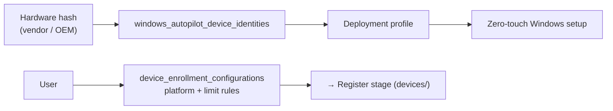

# Enrolment

The **enrol** stage: the gate a device passes through before Intune manages it.
Two things live here:

- **Enrolment configurations** (formerly "enrolment restrictions") — the rules:
  which platforms may enrol, how many devices a user may have, and in what order
  they are evaluated (priority).
- **Windows Autopilot identities** — hardware hashes registered *before* a
  device is ever turned on, so it can self-provision to a known configuration.



## Start here

```bash
python configurations.py --details
python autopilot.py --imported
```

| Script | What / why | Permissions |
|---|---|---|
| [`configurations.py`](./configurations.py) | List enrolment configurations with priority, version and assignment count. | `DeviceManagementServiceConfig.Read.All` |
| [`autopilot.py`](./autopilot.py) | Registered Autopilot devices (serial, model, group tag, enrolment state); `--imported` adds staged hashes. | `DeviceManagementServiceConfig.Read.All` |

## Why priority matters

When several configurations apply to a user, Intune uses the one with the
lowest **priority** number. `configurations.py` prints it so you can see which
rule actually wins — a common source of "why was this device blocked?".

## Official docs

- [List enrolment configurations](https://learn.microsoft.com/en-us/graph/api/intune-onboarding-deviceenrollmentconfiguration-list)
- [List Autopilot device identities](https://learn.microsoft.com/en-us/graph/api/intune-enrollment-windowsautopilotdeviceidentity-list)
- [Windows Autopilot](https://learn.microsoft.com/en-us/autopilot/windows-autopilot)
