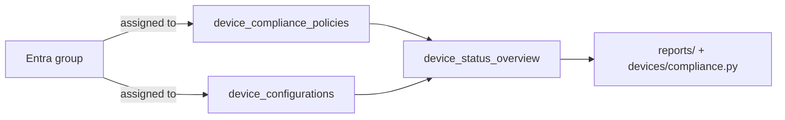

# Policies

The **configure** stage. Intune delivers two kinds of policy to devices:

- **Compliance policies** decide whether a device *may* access corporate
  resources (PIN, encryption, OS version, jailbreak). Conditional access reads
  this verdict.
- **Configuration profiles** push *settings* — Wi-Fi, VPN, certificates,
  restrictions — regardless of compliance.



## Start here

```bash
python compliance_policies.py --details
python configuration_profiles.py --details
```

| Script | What / why | Permissions |
|---|---|---|
| [`compliance_policies.py`](./compliance_policies.py) | Every compliance policy with version and, with `--details`, its assignment count and deployment status. | `DeviceManagementConfiguration.Read.All` |
| [`configuration_profiles.py`](./configuration_profiles.py) | Every configuration profile with assignment/status rollup. | `DeviceManagementConfiguration.Read.All` |

## How assignment works

Policies are **assigned to groups**, not devices. An assignment is a
`DeviceAndAppManagementAssignmentTarget` (a group, all users, or all devices).
Once a device receives a policy, its outcome is visible via
`device_status_overview` (success/failed/error/pending) and, per device, via
`devices/compliance.py`.

- **Creating/editing** a policy means `device_compliance_policies.add(...)` or
  `.get()...update()`; assigning is a separate `assign` action. This folder
  focuses on reading, which is the safe, common task.

## Official docs

- [List compliance policies](https://learn.microsoft.com/en-us/graph/api/intune-devices-devicecompliancepolicy-list)
- [List configuration profiles](https://learn.microsoft.com/en-us/graph/api/intune-deviceconfig-deviceconfiguration-list)
- [Assign a policy](https://learn.microsoft.com/en-us/graph/api/intune-devices-devicecompliancepolicy-assign)
