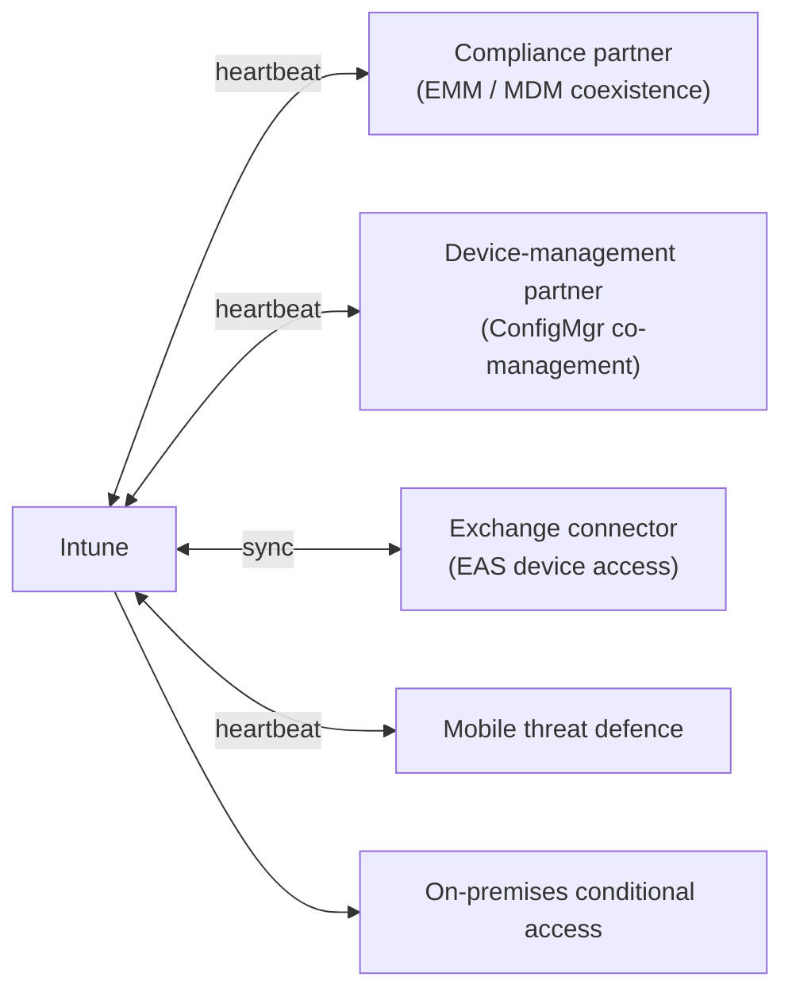

# Protection integrations

Intune does not protect devices alone — it exchanges signals with other
services. This folder inspects those integrations, because a **stale
heartbeat** is the usual reason compliance or conditional-access signals stop
flowing.



## Start here

```bash
python overview.py
```

| Script | What / why | Permissions |
|---|---|---|
| [`overview.py`](./overview.py) | Walks every connector — Exchange, device-management partners, compliance partners, threat defence — plus on-premises conditional access, and flags heartbeats older than a day. | `DeviceManagementServiceConfig.Read.All` + `DeviceManagementConfiguration.Read.All` |

## What to look for

- `partner_state` / `status` tells you whether the connector is
  `enabled`/`pending`/`disabled` — a connector can exist but be inactive.
- `last_heartbeat_date_time` older than about a day is a red flag; the script
  labels it `[stale]`.
- An Exchange connector governs whether Exchange ActiveSync blocks devices that
  break compliance.

## Official docs

- [List device-management partners](https://learn.microsoft.com/en-us/graph/api/intune-onboarding-devicemanagementpartner-list)
- [Get on-premises conditional access settings](https://learn.microsoft.com/en-us/graph/api/intune-onboarding-onpremisesconditionalaccesssettings-get)
- [Intune connectors](https://learn.microsoft.com/en-us/mem/intune/fundamentals/tenant-status)
