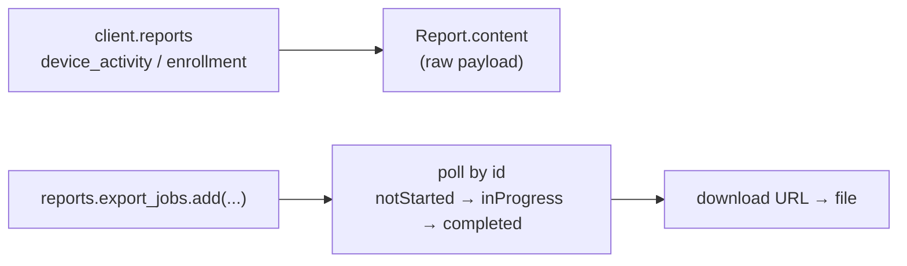

# Reports

The **govern** stage: turning raw state into answers. Intune exposes reports as
Graph *report functions* on `client.reports`, plus **export jobs** for reports
too large to return inline.



## Start here

```bash
python device_activity.py
python enrollment_failures.py
python export_jobs.py --report Devices
```

| Script | What / why | Permissions |
|---|---|---|
| [`device_activity.py`](./device_activity.py) | Device-configuration user/device activity. The report body can legitimately be empty; the script prints its size. | `DeviceManagementConfiguration.Read.All` |
| [`enrollment_failures.py`](./enrollment_failures.py) | Why enrolment failed (`failureDetails`) and the `topFailures` ranking, optionally scoped by `--period D30`. | `DeviceManagementManagedDevices.Read.All` |
| [`export_jobs.py`](./export_jobs.py) | **The long-running case.** Create an export job, poll it, download the result. | `DeviceManagementManagedDevices.Read.All` |

## The long-running export flow

`export_jobs.py` is the reference for an Intune LRO:

1. **Create** the job — Graph returns immediately with `status = notStarted`.
2. **Poll** `reports.export_jobs[<job-id>].get()` until `status = completed`
   (or `failed`). Note: **listing** `export_jobs` is not supported; always poll
   by id.
3. **Download** the pre-signed `url` the completed job exposes.

Because the job runs server-side, the script is bounded by `--timeout` and exits
cleanly if the report is still being generated:

```bash
python export_jobs.py --report Devices --timeout 300 --interval 15
```

The status is normalised case-insensitively, because Graph returns it as the
raw member name (`inProgress`).

## Official docs

- [Export job — create](https://learn.microsoft.com/en-us/graph/api/intune-reporting-devicemanagementexportjob-create)
- [Export job — get](https://learn.microsoft.com/en-us/graph/api/intune-reporting-devicemanagementexportjob-get)
- [Enrollment failure details](https://learn.microsoft.com/en-us/graph/api/intune-devices-manageddeviceenrollmentfailuredetails)
