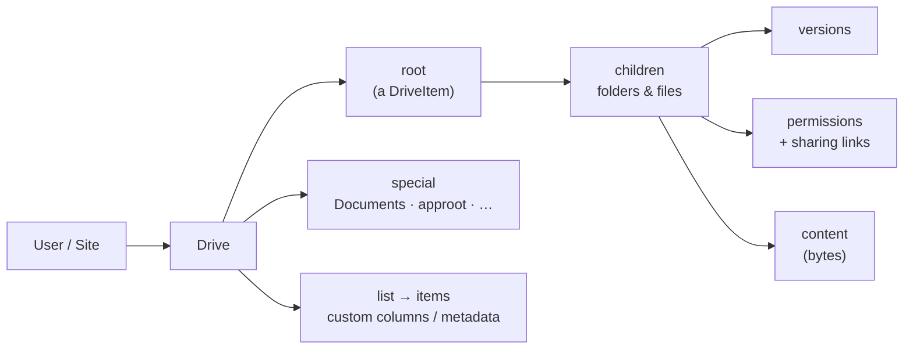
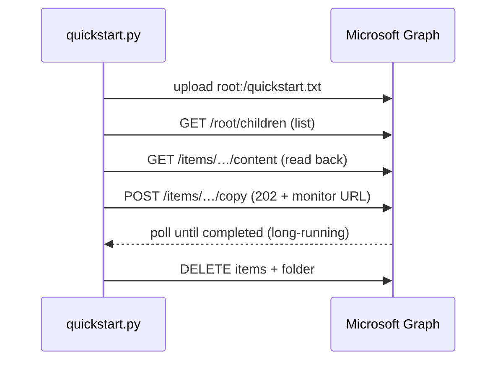

# OneDrive & SharePoint files — a guided tour

A **drive** is the file layer of Microsoft 365: every user has one
(`client.me.drive`), every site has one, and both speak the same
[driveItem](https://learn.microsoft.com/en-us/graph/api/resources/driveitem) API.
This page is a **tour** — read it top to bottom and you'll know the model, the
common tasks, and where the hard cases live.

> This client targets the **Graph endpoint** (`graph.microsoft.com`). Two things
> from the Microsoft docs you'll meet but *not* here: CORS / JavaScript (this is a
> server-side client) and `X-HTTP-Method` verb tunneling (Graph uses the real
> verb, e.g. `PATCH`).

---

## The model in one picture



Everything is a **`DriveItem`** addressed from a **`Drive`**; folders and files
are the same type (a `folder` or `file` facet tells them apart), and custom
metadata rides on the item's backing **`listItem`**.

---

## Start here (5 minutes)

```bash
cp .env.example .env
uv run python examples/onedrive/quickstart.py
```

[`quickstart.py`](./quickstart.py) walks the five operations you'll do most, end
to end, and cleans up after itself:



---

## Addressing items

Four ways to name a `DriveItem`. **Paths are case-sensitive**; ids are not.

```python
drive = client.me.drive

drive.root  # the drive root
drive.get_by_path("Reports/2024/Q1.xlsx")  # by path from the root
drive.items[item_id]  # by id (stable, shareable)
drive.special["Documents"]  # a special folder by name
```

| Want | Reach for | Example |
|---|---|---|
| Follow a path | `get_by_path` | [`sites/get_site_by_path.py`](./sites/get_site_by_path.py) |
| Address by id | `items[id]` | [`files/manage.py`](./files/manage.py) |
| A special / app folder | `drive.special` | [`appfolder/app_folder.py`](./appfolder/app_folder.py) |
| Another user's drive | `client.users[id].drive` | [`drives/user_drive.py`](./drives/user_drive.py) |
| A site's drive | `client.sites[id].drive` | [`lists/library.py`](./lists/library.py) |

---

## Working with files

Files are `DriveItem`s with a `file` facet. Upload small files in one call;
use a resumable session for large ones. Copy and move are metadata operations
(asynchronous for copy), so they're fast even for big files.

| Operation | Example |
|---|---|
| Upload & download (round-trip) | [`files/upload_download.py`](./files/upload_download.py) |
| Upload a large file (resumable session) | [`patterns/large-data/upload_large.py`](../patterns/large-data/upload_large.py) |
| Ensure a file exists (idempotent) | [`files/ensure_file.py`](./files/ensure_file.py) |
| Copy, rename, move, versions, delete | [`files/manage.py`](./files/manage.py) |
| Copy a large file and await it | [`patterns/lro/copy_and_wait.py`](../patterns/lro/copy_and_wait.py) |
| Check out, edit, check in | [`files/lifecycle.py`](./files/lifecycle.py) |
| Tag a file with custom metadata | [`files/custom_metadata.py`](./files/custom_metadata.py) |
| Read structured data back (JSON) | [`files/download_json.py`](./files/download_json.py) |

→ Guide: [`files/README.md`](./files/README.md)

## Working with folders

A folder is a `DriveItem` with a `folder` facet and a `children` collection.
Walk it, page it, download it as a zip, or upload a whole local tree.

| Operation | Example |
|---|---|
| Create & navigate folders | [`folders/manage.py`](./folders/manage.py) |
| Build a nested structure | [`folders/create_nested.py`](./folders/create_nested.py) |
| List everything, recursively | [`folders/list_recursive.py`](./folders/list_recursive.py) |
| Upload a local folder tree | [`folders/upload_folder.py`](./folders/upload_folder.py) |
| Download a folder (zip) / in parallel | [`folders/download_folder.py`](./folders/download_folder.py), [`patterns/large-data/download_parallel.py`](../patterns/large-data/download_parallel.py) |
| Rename, move, delete | [`folders/move_delete.py`](./folders/move_delete.py) |

→ Guide: [`folders/README.md`](./folders/README.md)

## Working with drives

A drive holds the items and reports quota/storage. Query it across the tenant for
governance and reporting.

| Operation | Example |
|---|---|
| Recent, shared-with-me, followed | [`drives/explore.py`](./drives/explore.py) |
| Search a keyword across all drives | [`drives/search_all.py`](./drives/search_all.py) |
| Tenant-wide storage report | [`drives/storage_report.py`](./drives/storage_report.py) |
| A user's drive and quota | [`drives/user_drive.py`](./drives/user_drive.py) |

→ Guide: [`drives/README.md`](./drives/README.md)

## Working with SharePoint sites

A site is a container of drives, lists, pages and permissions. Get it by URL or
path, then read or grant access.

| Operation | Example |
|---|---|
| Get the root / a site by path | [`sites/get_site.py`](./sites/get_site.py), [`sites/get_site_by_path.py`](./sites/get_site_by_path.py) |
| List all sites / subsites | [`sites/list_all.py`](./sites/list_all.py), [`sites/subsites.py`](./sites/subsites.py) |
| Who has access; grant & revoke | [`sites/site_permissions.py`](./sites/site_permissions.py), [`sites/grant_permission.py`](./sites/grant_permission.py) |
| Add / remove an owner | [`sites/add_admin.py`](./sites/add_admin.py), [`sites/remove_admin.py`](./sites/remove_admin.py) |
| Sharing link / external-sharing audit | [`sites/share_site_link.py`](./sites/share_site_link.py), [`sites/external_sharing.py`](./sites/external_sharing.py) |
| Analytics, activity, stale sites, CSV export | [`sites/analytics_report.py`](./sites/analytics_report.py), [`sites/find_stale.py`](./sites/find_stale.py), [`sites/export_csv.py`](./sites/export_csv.py) |

→ Guide: [`sites/README.md`](./sites/README.md)

## Working with document libraries (lists)

A document library is a **list** that also acts as a drive. Reach items as
`DriveItem`s *or* as list items with custom columns.

| Operation | Example |
|---|---|
| Create a library / list with columns | [`lists/create_list.py`](./lists/create_list.py) |
| Manage items (CRUD) & columns | [`lists/manage_items.py`](./lists/manage_items.py), [`lists/columns.py`](./lists/columns.py) |
| Query items (filter/select/order) | [`lists/query_items.py`](./lists/query_items.py) |
| Library as a drive | [`lists/library.py`](./lists/library.py) |
| Bulk import / export | [`lists/import_export.py`](./lists/import_export.py) |

→ Guide: [`lists/README.md`](./lists/README.md) · also [OData query parameters](../patterns/odata-query/)

## Working with site pages

Modern pages: create, lay out with web parts, and drive the check-in/publish
workflow.

| Operation | Example |
|---|---|
| Page lifecycle (create/update/publish/delete) | [`pages/manage.py`](./pages/manage.py) |
| List pages with publishing state | [`pages/list_pages.py`](./pages/list_pages.py) |
| Check in & publish | [`pages/publish_flow.py`](./pages/publish_flow.py) |
| Inspect web parts | [`pages/webparts.py`](./pages/webparts.py) |

→ Guide: [`pages/README.md`](./pages/README.md)

## Working with the term store

The managed taxonomy: **groups → sets → terms**. Import, export, search and
clean it up.

| Operation | Example |
|---|---|
| Create groups, sets, terms | [`termstore/create_terms.py`](./termstore/create_terms.py) |
| Search by term label | [`termstore/search_term.py`](./termstore/search_term.py) |
| Export the hierarchy | [`termstore/export_store.py`](./termstore/export_store.py) |
| Import from JSON | [`termstore/import_store.py`](./termstore/import_store.py) |

→ Guide: [`termstore/README.md`](./termstore/README.md)

## Working with Excel workbooks

An `.xlsx` in a drive is a workbook you can drive server-side — sessions, tables,
ranges and formulas — without downloading it.

| Operation | Example |
|---|---|
| Read tables & data | [`excel/read_table.py`](./excel/read_table.py) |
| Workbook sessions | [`excel/workbook_sessions.py`](./excel/workbook_sessions.py) |
| Tables, worksheets, ranges | [`excel/tables.py`](./excel/tables.py), [`excel/worksheets.py`](./excel/worksheets.py), [`excel/ranges.py`](./excel/ranges.py) |

→ Guide: [`excel/README.md`](./excel/README.md)

## Working with change notifications

Instead of polling a drive, have Graph **push** an HTTPS notification when
something changes.

| Operation | Example |
|---|---|
| Subscribe, renew, remove | [`webhooks/subscribe_to_drive.py`](./webhooks/subscribe_to_drive.py) |
| Reconcile after downtime (delta) | [`files/delta_query.py`](./files/delta_query.py) |

→ Guide: [`webhooks/README.md`](./webhooks/README.md)

---

## Going further (patterns)

Cross-cutting and advanced scenarios live in [`../patterns/`](../patterns/) so
they're reusable across products:

| When you need | Pattern |
|---|---|
| Copy/clone/export that returns `202 Accepted` | [`patterns/lro/`](../patterns/lro/) · [monitor CLI](../patterns/lro/monitor_cli.py) |
| Concurrency, async twins, batching | [`patterns/async/`](../patterns/async/) |
| Resumable uploads, parallel downloads, exports | [`patterns/large-data/`](../patterns/large-data/) |
| `$select` / `$filter` / `$orderby` / `$expand` | [`patterns/odata-query/`](../patterns/odata-query/) |
| Errors, throttling, retries | [`patterns/reliability/`](../patterns/reliability/) |

---

## Permissions & least privilege

Pick the narrowest scope that works. Examples use the **delegated**
username/password flow from `tests.settings`; the same builders accept any
credential (see the `auth/` examples).

| Permission | Grants |
|---|---|
| `Files.Read` | Read, search, delta, analytics |
| `Files.ReadWrite` | Upload, download, copy, move, share — **the common default** |
| `Files.ReadWrite.All` | Above, plus any user's drive and the recycle bin |
| `Files.ReadWrite.AppFolder` | Only the app's private `approot` folder |
| `Sites.Read[Write].All` | Sites, lists, pages, term store |
| `Analytics.Read` | File activity stats |

---

## Recommendations & gotchas

- **Copy is long-running.** A `copy()` answers `202`; await it (or poll the
  monitor URL). Never fire-and-forget — and never batch it (the monitor URL is
  lost). → [`patterns/lro/lro_in_batch_guard.py`](../patterns/lro/lro_in_batch_guard.py)
- **Paths are case-sensitive**; ids are not. Prefer ids for anything durable.
- **`parentReference` before copy/move**: load the destination
  (`dest.get().execute_query()`) so the payload carries the drive id.
- **Delta tokens are opaque** — persist and replay the returned link.
- **Throttling is normal**: honor `Retry-After` (the LRO poller does it for you).
- **Upload sessions expire**; large uploads should resume, not restart.

---

## Official docs

- [OneDrive API concepts](https://learn.microsoft.com/en-us/onedrive/developer/rest-api/concepts/)
- [driveItem](https://learn.microsoft.com/en-us/graph/api/resources/driveitem) · [Drive](https://learn.microsoft.com/en-us/graph/api/resources/drive)
- [Long-running actions](https://learn.microsoft.com/en-us/graph/long-running-actions-overview)
- [SharePoint sites](https://learn.microsoft.com/en-us/graph/api/resources/sharepoint) · [lists](https://learn.microsoft.com/en-us/graph/api/resources/list) · [term store](https://learn.microsoft.com/en-us/graph/api/resources/termstore-store) · [Excel](https://learn.microsoft.com/en-us/graph/api/resources/excel)
