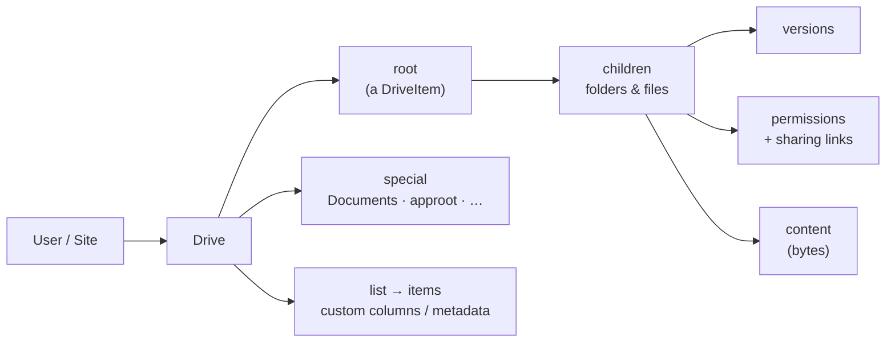
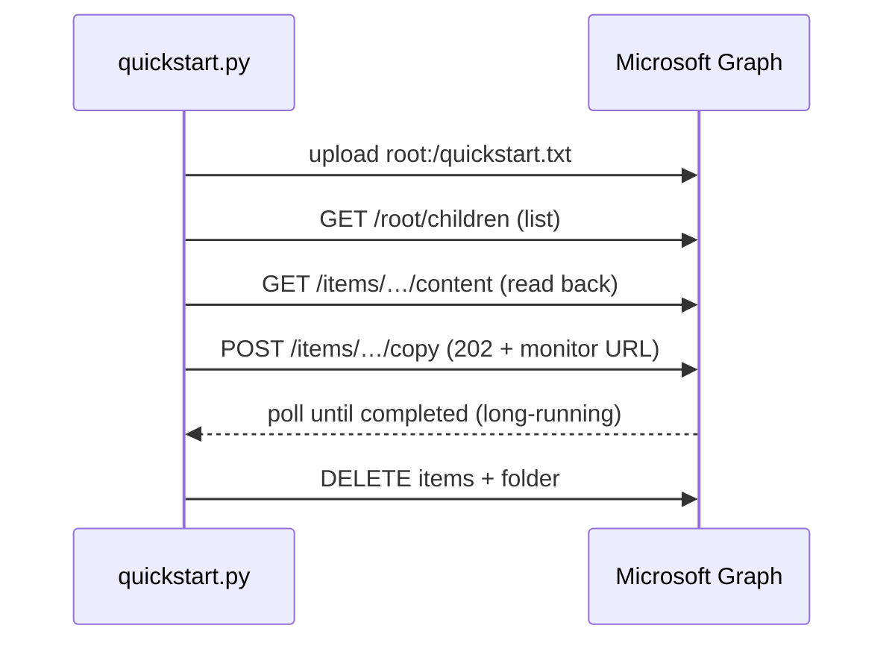

# OneDrive & SharePoint files — a guided tour

A drive is the file layer of Microsoft 365: a user has one (`client.me.drive`),
every site has one, and both speak the same [driveItem](https://learn.microsoft.com/en-us/graph/api/resources/driveitem) API.
This page is a **tour** — read it top to bottom and you'll know the model, the
everyday tasks, and where the hard cases live. The per-folder READMEs and the
[`patterns/`](../patterns/) tree are the reference behind it.

> Both the **Graph endpoint** (`graph.microsoft.com`) and the legacy **OneDrive
> direct endpoint** (`api.onedrive.com`) implement this model; this client targets
> Graph. Two things you'll meet in the Microsoft docs but *not* here: CORS /
> JavaScript (this is a server-side client) and `X-HTTP-Method` verb tunneling
> (Graph uses the real verb, e.g. `PATCH`).

---

## The model in one picture



Everything is a **`DriveItem`** addressed from a **`Drive`**. Folders and files
are the same type; a `folder` facet or a `file` facet tells them apart. Custom
metadata rides on the item's backing **`listItem`**.

---

## Start here (5 minutes)

There's one script to run first. It walks the five operations you'll do most,
end to end, and cleans up after itself:

```bash
cp .env.example .env
uv run python examples/onedrive/quickstart.py
```



Every step below links to a focused example for the same operation.

---

## Addressing items

Before anything else, learn the four ways to name a `DriveItem` — and that
**paths are case-sensitive** (item *names* keep their case, but lookups by path
must match it exactly):

```python
drive = client.me.drive

drive.root  # the drive root
drive.get_by_path("Reports/2024/Q1.xlsx")  # by path from the root
drive.items[item_id]  # by id (stable, shareable)
drive.special["Documents"]  # a special folder by name
```

| Want | Reach for | Example |
|---|---|---|
| Follow a path | `get_by_path` | [`sites/get_site_by_path.py`](./sites/get_site_by_path.py) |
| Address by id | `items[id]` | [`files/manage.py`](./files/manage.py) |
| Listed/app folders | `drive.special` | [`appfolder/app_folder.py`](./appfolder/app_folder.py) |
| A different user's drive | `client.users[id].drive` | [`drives/user_drive.py`](./drives/user_drive.py) |
| A site's drive | `client.sites[id].drive` | [`lists/library.py`](./lists/library.py) |

---

## Everyday tasks (the 80%)

Short prose + one link each; open them in any order.

**Upload & download.** Small files go up in one call; large files use a
resumable session. → [`files/upload_download.py`](./files/upload_download.py),
[`patterns/large-data/upload_large.py`](../patterns/large-data/upload_large.py)

**List & page.** Enumerate a folder's children, recursively if needed. →
[`folders/list_recursive.py`](./folders/list_recursive.py)

**Copy, rename, move, delete.** Copy is a *long-running* action — see
[Going further](#going-further-patterns). → [`files/manage.py`](./files/manage.py),
[`folders/manage.py`](./folders/manage.py)

**Share.** Create a link or invite people; manage the links later. →
[`files/sharing.py`](./files/sharing.py)

**Versions & checkout.** Keep history, edit with check-out/check-in. →
[`files/lifecycle.py`](./files/lifecycle.py)

**Custom metadata.** Tag files with your own columns. →
[`files/custom_metadata.py`](./files/custom_metadata.py)

**Search & discover.** Keyword search, largest files, what's shared. →
[`files/search.py`](./files/search.py),
[`files/largest_files.py`](./files/largest_files.py),
[`drives/explore.py`](./drives/explore.py)

**Recycle bin.** Restore or purge. → [`files/recycle_bin.py`](./files/recycle_bin.py)

---

## Going further (patterns)

Advanced or cross-cutting scenarios live in [`../patterns/`](../patterns/) so
they're reusable across products:

| When you need | Pattern | Start with |
|---|---|---|
| Copy/clone/export that returns `202 Accepted` | **Long-running operations** | [`patterns/lro/`](../patterns/lro/) · [monitor CLI](../patterns/lro/monitor_cli.py) |
| Concurrency, async twins, batching | **Async** | [`patterns/async/`](../patterns/async/) |
| Resumable uploads, parallel downloads, exports | **Large data** | [`patterns/large-data/`](../patterns/large-data/) |
| Keeping a local cache in sync | **Delta query** | [`files/delta_query.py`](./files/delta_query.py) |

See [Long-running operations](../patterns/lro/README.md) for the three levels of
help (waitable result → operation entity → raw poller) and the **monitor CLI**.

---

## The rest of the surface

Files are only part of what a drive/site exposes. Each area has its own guide:

| Area | What it covers | Guide |
|---|---|---|
| **Files & folders** | upload, download, copy, move, share, versions, recycle bin, search | [`files/`](./files/README.md), [`folders/`](./folders/README.md) |
| **Drives** | user drive, storage, cross-drive search | [`drives/`](./drives/README.md) |
| **Sites** | get, permissions, admins, sharing, governance | [`sites/`](./sites/README.md) |
| **Lists** | document libraries, items, columns | [`lists/`](./lists/README.md) |
| **Pages** | site pages, publishing, web parts | [`pages/`](./pages/README.md) |
| **Term store** | taxonomy: groups → sets → terms | [`termstore/`](./termstore/README.md) |
| **Excel** | workbook sessions, tables, ranges, formulas | [`excel/`](./excel/README.md) |

---

## Permissions & least privilege

Pick the narrowest scope that works; most examples use the **delegated**
username/password flow from `tests.settings`, but the same builders accept any
credential (see the `auth/` examples).

| Permission | Grants |
|---|---|
| `Files.Read` | Read, search, delta, analytics |
| `Files.ReadWrite` | Upload, download, copy, move, share — **the common default** |
| `Files.ReadWrite.All` | Above, plus any user's drive and the recycle bin |
| `Sites.Read[Write].All` | Sites, lists, pages, term store |
| `Analytics.Read` | File activity stats |

---

## Recommendations & gotchas

- **Copy is long-running.** A `copy()` answers `202`; await it (or poll the
  monitor URL). Never fire-and-forget — and never batch it (the monitor URL is
  lost). → [`patterns/lro/lro_in_batch_guard.py`](../patterns/lro/lro_in_batch_guard.py)
- **Paths are case-sensitive**; ids are not. Prefer ids for anything durable.
- **`parentReference` before copy/move**: the destination must be loaded
  (`dest.get().execute_query()`) so the payload carries the drive id.
- **Delta tokens are opaque** — persist and replay the returned link, don't
  construct it.
- **Throttling is normal**: honor `Retry-After` (the LRO poller does it for you;
  see [`patterns/async/retry_async.py`](../patterns/async/retry_async.py)).
- **Upload sessions expire**; large uploads should resume, not restart.

---

## Official docs

- [OneDrive API concepts](https://learn.microsoft.com/en-us/onedrive/developer/rest-api/concepts/)
- [driveItem](https://learn.microsoft.com/en-us/graph/api/resources/driveitem) · [Drive](https://learn.microsoft.com/en-us/graph/api/resources/drive)
- [Long-running actions](https://learn.microsoft.com/en-us/graph/long-running-actions-overview)
- [SharePoint sites](https://learn.microsoft.com/en-us/graph/api/resources/sharepoint) · [lists](https://learn.microsoft.com/en-us/graph/api/resources/list) · [term store](https://learn.microsoft.com/en-us/graph/api/resources/termstore-store) · [Excel](https://learn.microsoft.com/en-us/graph/api/resources/excel)
