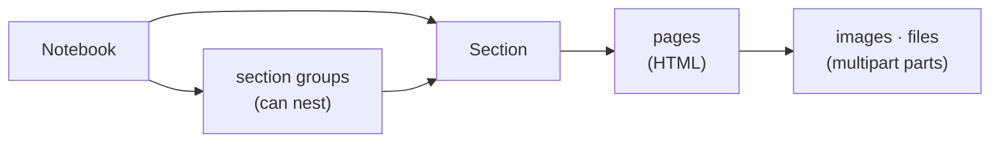

# Microsoft OneNote — a guided tour

OneNote is a **notebook** product and the API mirrors that: content lives in a
four-level tree — **notebook → section group → section → page** — and every page
is stored as **HTML**. This page is a **tour**: read it top to bottom and you'll
know how the model fits together, where the sharp edges are, and which script to
open next.

> This client targets the **Graph endpoint** (`graph.microsoft.com`). The same
> notebooks are reachable for a signed-in user (`client.me.onenote`), a group
> (`client.groups.get_by_id(id).onenote`) and a SharePoint site
> (`client.sites.get_by_id(id).onenote`).

---

## The model in one picture



Everything hangs off a **notebook**; section groups are just folders for
sections, and a **page** is HTML you submit (and get back) as a document. The
page HTML can reference binary parts — images and file attachments — that ride
along in the same multipart request.

---

## Start here (5 minutes)

```bash
cp .env.example .env
uv run python examples/onenote/quickstart.py
```

[`quickstart.py`](./quickstart.py) is read-only: it lists your notebooks, then
opens the default one to show its sections and the pages in each.

---

## Reading the tree

There is **no call that returns every page** — you read the tree one notebook at
a time. Notebooks, sections and pages all support `$filter`, so a natural key
like a name is enough to address one:

```python
notebook = client.me.onenote.notebooks.first_or_none("displayName eq 'Project X'").execute_query()
section = notebook.sections.first_or_none("displayName eq 'Meeting Notes'").execute_query()
pages = section.pages.top(10).get().execute_query()
html = client.me.onenote.pages[pages[0].id].get_content().execute_query().value
```

→ [`quickstart.py`](./quickstart.py) · [`pages/read.py`](./pages/read.py) ·
[`audit/structure.py`](./audit/structure.py)

---

## The resources

| Folder | What it covers |
|---|---|
| [`notebooks/`](./notebooks/README.md) | Create a notebook, see your recent ones, provision one from a template |
| [`pages/`](./pages/README.md) | Create pages from HTML, embed images and file attachments, download a page back |
| [`audit/`](./audit/README.md) | Walk the whole hierarchy (section groups included) as a tree or JSON |

---

## Writing pages

A page is created by `POST`ing HTML — headings, lists, tables and styled spans
all translate into OneNote content. The library builds the `multipart/form-data`
body for you: pass the HTML as the presentation part and a mapping from the part
name used in the HTML to the file.

```python
page = section.pages.add(
    presentation_file="<html><head><title>Notes</title></head><body><p>Hello</p></body></html>",
).execute_query()
```

→ [`pages/create.py`](./pages/create.py) · [`pages/attachments.py`](./pages/attachments.py)

---

## Permissions

| Permission | Lets you |
|---|---|
| `Notes.Read` | Read notebooks, sections and pages |
| `Notes.ReadWrite` | Also create and update pages, sections and notebooks |
| `Notes.Create` | Create notebooks (and pages) for the signed-in user |
| `Notes.ReadWrite.All` / `Notes.Read.All` | The same, without a signed-in user |

---

## Sharp edges

These are service behaviours worth knowing before you are surprised by them:

- **Notebooks cannot be deleted** through Graph. The API exposes list, create,
  get, update and copy — but no delete. Remove them from OneNote directly.
- **`GET /me/onenote/pages` (all pages) is not supported in every tenant** — read
  pages per section instead, which is what these scripts do.
- **Creating a page is a multipart request.** Plain JSON with a `content` field
  is rejected; the HTML must be a `Presentation` part (the library handles this).
- **Attachments are referenced by name.** The part name in the multipart body
  must match the `name:` reference in the HTML (``).
- **`$select` drops `id`.** Unlike most Graph resources, OneNote honours
  `$select` strictly, so `pages.select(["title"]).get()` returns pages with no
  `id` — and no resource path to fetch their content. Include `"id"` in the
  selection whenever you'll act on the item afterwards.
- **Fetch page content from the top-level path.** A page's HTML lives at
  `/onenote/pages/{id}/content`; the nested `/onenote/sections/{id}/pages/{id}/content`
  form is rejected. Address the page from `client.me.onenote.pages[id]` first.

---

## Official docs

- [OneNote API overview](https://learn.microsoft.com/en-us/graph/api/resources/onenote-api-overview)
- [Create OneNote pages](https://learn.microsoft.com/en-us/graph/onenote-create-page)
- [Get OneNote content](https://learn.microsoft.com/en-us/graph/onenote-get-content)
- [Input and output HTML](https://learn.microsoft.com/en-us/graph/onenote-input-output-html)
