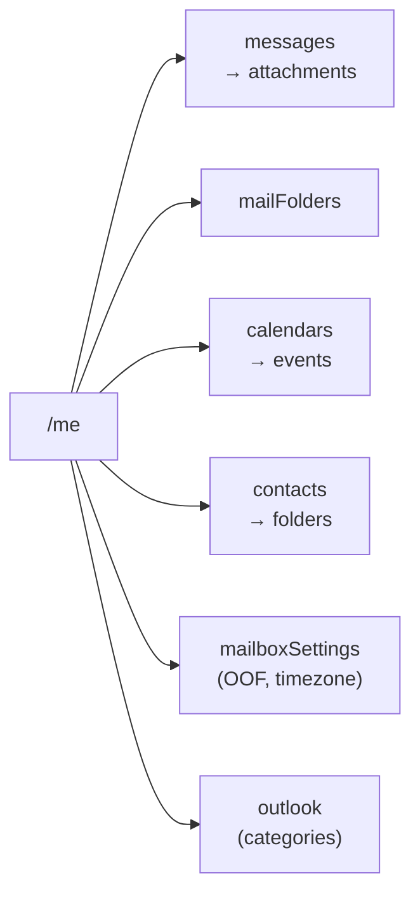

# Outlook — a guided tour

Outlook in Microsoft Graph is three related resources under the signed-in user:
**mail** (`/me/messages`, folders, attachments), **calendar**
(`/me/events`, calendars, rooms) and **contacts** (`/me/contacts`). This page is
a tour — read it top to bottom for the model, the everyday tasks, and the hard
cases. Each section links to a runnable example.



> Other users' mailboxes, shared mailboxes and rooms are reached the same way,
> addressed by id/UPN — see [Shared mailboxes](#shared-mailboxes) and
> [Rooms & meeting locations](#rooms-meeting-locations).

## Start here

```bash
cp .env.example .env
uv run python examples/outlook/messages/send.py
```

## Common recipes (copy-paste)

Short, runnable answers to the questions people actually ask.

**Send a message** — the one-liner:

```python
client.me.send_mail(subject="Hi", body="Hello!", to_recipients=["a@contoso.com"]).execute_query()
```

**Send with an attachment** (small file inline, large via upload session):

```python
client.me.messages.add(subject="Report", to_recipients=["a@contoso.com"]).upload_attachment(
    "report.pdf"
).send().execute_query()
```

**Read the newest unread mail**:

```python
for m in client.me.mail_folders["inbox"].messages.filter("isRead eq false").top(10).get().execute_query():
    print(m.subject, m.from_recipient.emailAddress.address)
```

**Send from a shared mailbox (Send As)**:

```python
client.users["support@contoso.com"].send_mail(
    subject="From support", body="...", to_recipients=["a@contoso.com"]
).execute_query()
```

**Create an event and get its Teams join link**:

```python
event = client.me.calendar.events.add(
    subject="Sync",
    start=when,
    end=when + timedelta(minutes=30),
    isOnlineMeeting=True,
    onlineMeetingProvider="teamsForBusiness",
).execute_query()
print(event.online_meeting.join_url)
```

**Find an available room**:

```python
for room in client.places.rooms.get().execute_query():
    print(room.display_name, room.email_address)
```

**Detect users forwarding mail externally** (governance):

```bash
uv run python examples/outlook/mail_flow/forwarding_report.py
```

## Working with messages

Send, reply, forward, move and delete. `send_mail` is the one-liner; for
anything richer, build a `Message` (or a draft) and act on it.

```python
client.me.send_mail(subject="Hello", body="Hi!", to_recipients=["a@contoso.com"]).execute_query()

msg = client.me.messages.add(subject="Draft", body="...").execute_query()  # a draft
msg.send().execute_query()
```

→ [`send.py`](./messages/send.py) · [`lifecycle.py`](./messages/lifecycle.py) (reply/forward/move/copy)
· [`send_with_large_attachment.py`](./messages/send_with_large_attachment.py) (upload session)

**Folders, search & paging.** Walk folders, search with KQL/`$filter`, and page
through thousands of messages.

→ [`folders.py`](./messages/folders.py) · [`search.py`](./messages/search.py) · [`pagination.py`](./messages/pagination.py)

**Rules, categories & settings.** Automate handling with inbox rules, tag with
master categories, set automatic replies (out of office).

→ [`inbox_rules.py`](./messages/inbox_rules.py) · [`categories.py`](./messages/categories.py) · [`mailbox_settings.py`](./messages/mailbox_settings.py)

**Mail tips & attachments.** Pre-flight checks (OOF, size limits) and attachment
handling.

→ [`mail_tips.py`](./messages/mail_tips.py) · [`attachments.py`](./messages/attachments.py)

## Working with calendars & events

Create events, invite attendees, handle responses, and share calendars.
`is_online_meeting` turns an event into a Teams meeting and returns the join URL.

```python
event = client.me.calendar.events.add(
    subject="Standup",
    start=...,
    end=...,
    is_online_meeting=True,
    online_meeting_provider="teamsForBusiness",
).execute_query()
print(event.online_meeting.join_url)
```

→ [`events/create.py`](./events/create.py) · [`events/recurring.py`](./events/recurring.py) (recurrence)
· [`events/respond.py`](./events/respond.py) · [`events/online_meeting.py`](./events/online_meeting.py)

**Availability & scheduling.** Free/busy lookups and finding a time everyone can
attend.

→ [`calendars/availability.py`](./calendars/availability.py)

**Sharing & delegation.** Grant read access or editor/delegate rights on a calendar.

→ [`calendars/share.py`](./calendars/share.py) · [`calendars/delegate.py`](./calendars/delegate.py)

## Rooms & meeting locations

Rooms and room lists come from the **places** API (`Place.Read.All`); use them to
pick a location or invite a room.

```python
for room in client.places.rooms.get().execute_query():
    print(room.display_name, room.email_address)
for room_list in client.places.room_lists.get().execute_query():
    print(room_list.display_name)
```

→ [`calendars/rooms.py`](./calendars/rooms.py)

## Working with contacts

Personal contacts live in contact folders; export/import them for CRM sync.

```python
client.me.contacts.add(given_name="Ada", email_addresses=[...]).execute_query()
```

→ [`contacts/manage.py`](./contacts/manage.py) · [`contacts/export_csv.py`](./contacts/export_csv.py) · [`contacts/import_csv.py`](./contacts/import_csv.py)

## Shared mailboxes

A shared mailbox is just another mailbox you address by its UPN — read it, send
from it (`/users/{upn}/sendMail`), or send *as* it.

```python
shared = client.users["shared@contoso.com"]
messages = shared.messages.top(10).get().execute_query()
client.users["shared@contoso.com"].send_mail(subject="From shared", to_recipients=[...]).execute_query()
```

→ [`shared_mailboxes/access_mailbox.py`](./shared_mailboxes/access_mailbox.py)
· [`shared_mailboxes/list_shared_mailboxes.py`](./shared_mailboxes/list_shared_mailboxes.py)
· [`shared_mailboxes/send_as.py`](./shared_mailboxes/send_as.py)
· [`shared_mailboxes/report.py`](./shared_mailboxes/report.py)

## Export & import

Bulk moves for retention, backup and migration — the same `export_to` /
`from_records` pipeline used across the library.

| What | Example |
|---|---|
| Messages → CSV / JSON | [`messages/export_folder_csv.py`](./messages/export_folder_csv.py) · [`messages/export_json.py`](./messages/export_json.py) |
| Message → MIME (`.eml`) | [`messages/export_mime.py`](./messages/export_mime.py) |
| Folder tree → portable EML (resumable, verified) | [`migration/export/export_folder_eml.py`](./migration/export/export_folder_eml.py) |
| Portable EML → mailbox (folders + flags restored) | [`migration/import/import_folder_eml.py`](./migration/import/import_folder_eml.py) |
| Calendar → portable ICS (resumable, verified) | [`migration/export/export_calendar_ics.py`](./migration/export/export_calendar_ics.py) |
| Attachments out of a folder | [`messages/export_attachments.py`](./messages/export_attachments.py) |
| A whole folder, concurrently | [`messages/export_mail_async.py`](./messages/export_mail_async.py) |
| Contacts → CSV / CSV → contacts | [`contacts/export_csv.py`](./contacts/export_csv.py) · [`contacts/import_csv.py`](./contacts/import_csv.py) |
| Events → CSV | [`calendars/events_export_csv.py`](./calendars/events_export_csv.py) |

## Administration & reporting

Mailbox usage, per-user mailbox settings, shared-mailbox inventory, and mail-flow
(external forwarding) auditing.

→ [`reports/email_usage.py`](./reports/email_usage.py) · [`mailboxes/report.py`](./mailboxes/report.py)
· [`mail_flow/forwarding_report.py`](./mail_flow/forwarding_report.py)

## Housekeeping

Retention and storage clean-up — all dry-run first, so they're safe to try.

→ [`messages/large_messages.py`](./messages/large_messages.py) · [`messages/cleanup_old.py`](./messages/cleanup_old.py)
· [`messages/archive_old.py`](./messages/archive_old.py) · [`calendars/events_cleanup.py`](./calendars/events_cleanup.py)
· [`calendars/events_copy.py`](./calendars/events_copy.py) · [`calendars/external_attendees.py`](./calendars/external_attendees.py)
· [`calendars/permissions_report.py`](./calendars/permissions_report.py) · [`migration/assess/scan_mailbox.py`](./migration/assess/scan_mailbox.py)

## Permissions & gotchas

| Permission | Grants |
|---|---|
| `Mail.Read` / `Mail.ReadWrite` | Read / manage messages, folders, attachments |
| `Mail.Send` | Send mail (own or shared mailbox) |
| `MailboxSettings.ReadWrite` | Automatic replies, rules |
| `Calendars.Read` / `Calendars.ReadWrite` | Read / manage events and calendars |
| `Contacts.ReadWrite` | Contacts |
| `Place.Read.All` | Rooms and room lists |
| `Mail.Read` (app) + `User.Read.All` | Tenant-wide mail audit/reporting |

- **`send_mail` sends immediately**; to stage, create a draft (`messages.add`) and
  call `.send()` when ready.
- **Attachments over ~3 MB** must go through an upload session — see
  `send_with_large_attachment.py`.
- **`$search` and `$filter` are mutually exclusive** on messages.
- **Shared mailboxes are plain mailboxes** addressed by UPN; your app needs
  delegated access (or app permissions) on that mailbox.

## Official docs

- [message](https://learn.microsoft.com/en-us/graph/api/resources/message) · [mailFolder](https://learn.microsoft.com/en-us/graph/api/resources/mailfolder) · [attachment](https://learn.microsoft.com/en-us/graph/api/resources/attachment)
- [event](https://learn.microsoft.com/en-us/graph/api/resources/event) · [calendar](https://learn.microsoft.com/en-us/graph/api/resources/calendar) · [place](https://learn.microsoft.com/en-us/graph/api/resources/place)
- [contact](https://learn.microsoft.com/en-us/graph/api/resources/contact) · [outlookCategory](https://learn.microsoft.com/en-us/graph/api/resources/outlookcategory)
