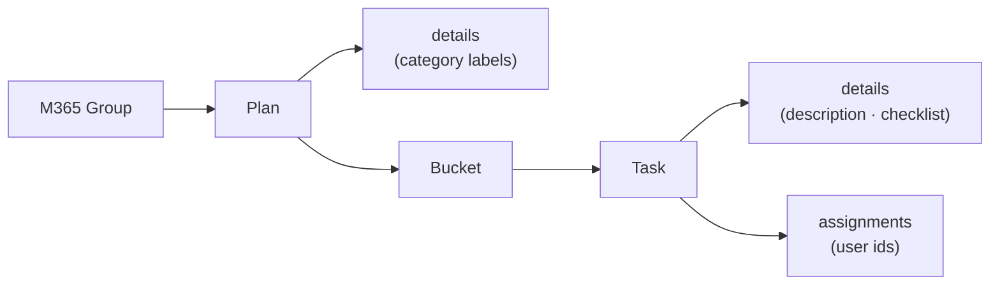

# Microsoft Planner — a guided tour

Microsoft Planner is the task board behind Microsoft 365 groups: a **plan** is
owned by a group and holds **buckets** (the columns of the board) and **tasks**
(the work items). This page is a **tour** — read it top to bottom and you'll know
how the model fits together, where the sharp edges are, and which script to open
next.

> This client targets the **Graph endpoint** (`graph.microsoft.com`). Plans are
> reached through a Microsoft 365 group (`client.groups.get_by_id(id).planner`)
> or the signed-in user (`client.me.planner`).

---

## The model in one picture



A **plan** belongs to a Microsoft 365 group and contains **buckets** — the
columns of the board. A **task** lives in a plan (optionally in a bucket) and
carries its own **details** object: the description and the checklist. Tasks are
assigned to users through an **assignments** map keyed by user id.

---

## Start here (5 minutes)

```bash
cp .env.example .env
uv run python examples/planner/quickstart.py
```

[`quickstart.py`](./quickstart.py) is read-only: it lists the plans you can
access and the buckets and tasks inside each.

---

## The resources

| Folder | What it covers |
|---|---|
| [`plans/`](./plans/README.md) | Create, rename and delete a plan; label its categories; provision a whole plan from a template |
| [`buckets/`](./buckets/README.md) | Add, rename, look up and delete board buckets |
| [`tasks/`](./tasks/README.md) | Task lifecycle, assignments, task details (description + checklist), and querying |
| [`reports/`](./reports/README.md) | Cross-plan reporting — overdue and due-soon tasks |

---

## Creating and addressing

A plan is created **for a group**, so the group comes first:

```python
group = client.groups.filter("groupTypes/any(a:a eq 'unified')").top(1).get().execute_query()[0]
plan = client.planner.plans.add("Sprint 7", group).execute_query()
```

Buckets and tasks are created through the plan, and the library routes each to
the top-level set for you (Graph only allows creating them there):

```python
bucket = plan.buckets.add("Backlog").execute_query()
task = plan.tasks.add("Draft proposal", bucket=bucket).execute_query()
task.assign_to(client.me.get().execute_query()).update().execute_query()
```

→ [`plans/lifecycle.py`](./plans/lifecycle.py) · [`tasks/lifecycle.py`](./tasks/lifecycle.py) ·
[`tasks/assignments.py`](./tasks/assignments.py)

---

## Permissions

| Permission | Lets you |
|---|---|
| `Tasks.Read` | Read plans, buckets and tasks |
| `Tasks.ReadWrite` | Also create and update them |
| `Group.Read.All` | Read a group's plans |
| `Group.ReadWrite.All` | Create a plan in a group |
| `Tasks.ReadWrite.All` | App-only equivalent of `Tasks.ReadWrite` |

---

## Sharp edges

- **There is no "list all plans" endpoint.** Enumerate the groups (or use
  `client.me.planner.plans`) and read each plan. `GET /planner/plans` returns
  *“This entity set must be queried with a filter on owner property…”*.
- **A plan's tasks and buckets ignore `$filter`, `$orderby` and `$top`.** List
  them through the plan, then filter and sort in Python. Only `$select` and the
  top-level `$filter=planId eq '…'` are honoured. See
  [`tasks/query.py`](./tasks/query.py).
- **The top-level `/planner/buckets` set cannot be listed.** Create buckets
  through `plan.buckets.add(...)` (which `POST`s to `/planner/buckets`) and list
  them back through the plan.
- **Updates and deletes carry the latest etag.** Graph enforces optimistic
  concurrency; `update()` and `delete_object()` send `If-Match`, and the library
  refreshes the etag after every update (Planner only returns it when asked with
  `Prefer: return=representation`). You never touch the etag yourself.
- **Task references (`references`) are rejected by the v1.0 endpoint** for every
  key form, so this tour does not use them — keep links in the description.
- **The checklist is an Open Type keyed by a client-generated id, and PATCH
  merges it.** Removing an item means sending `null` for its id;
  `set_checklist([...])` does that when you want to replace the whole list. See
  [`tasks/details.py`](./tasks/details.py).

---

## Official docs

- [Planner API overview](https://learn.microsoft.com/en-us/graph/api/resources/planner-overview)
- [plannerPlan](https://learn.microsoft.com/en-us/graph/api/resources/plannerplan)
- [plannerBucket](https://learn.microsoft.com/en-us/graph/api/resources/plannerbucket)
- [plannerTask](https://learn.microsoft.com/en-us/graph/api/resources/plannertask)
- [plannerTaskDetails](https://learn.microsoft.com/en-us/graph/api/resources/plannertaskdetails)
- [plannerAssignments](https://learn.microsoft.com/en-us/graph/api/resources/plannerassignments)
