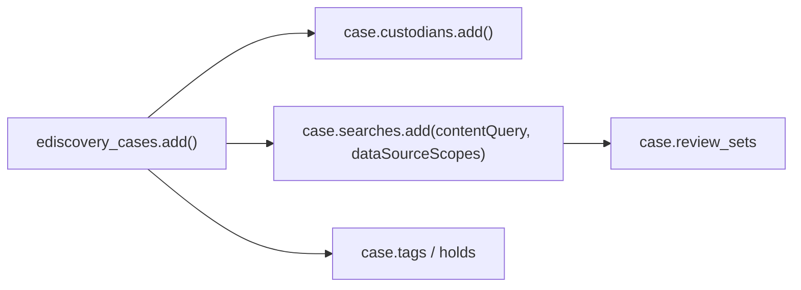

# eDiscovery

eDiscovery (Premium) is how an organisation collects, holds, searches and
reviews content for a legal or internal investigation. Everything hangs off a
**case**, and the same `client.security.cases.ediscovery_cases` root drives all
of it.



## [Run a case workflow](cases.py)

Creates a case, adds a custodian, defines a search, and (unless `--keep`) deletes
the case. This is the smallest complete unit of work — the starting point for
anything else.

```python
case = client.security.cases.ediscovery_cases.add(displayName="...", description="...").execute_query()
case.custodians.add(email=args.custodian).execute_query()
case.searches.add(displayName="...", contentQuery=args.query).execute_query()
```

```bash
python cases.py
python cases.py --custodian investigator@contoso.com --query "subject:'confidential'"
python cases.py --keep
```

## [Search partially indexed items](search.py)

Partially indexed items (unsupported types, encrypted content, indexing
failures) are invisible to a normal search. A non-custodial search scoped with
`dataSourceScopes` is how you reach them.

```python
search = case.searches.add(
    displayName="Partially indexed items",
    contentQuery="*",
    dataSourceScopes="allTenantMailboxes,allTenantSites",
).execute_query()
```

## [List review sets](review_sets.py)

Read-only inventory of the documents collected into a case for review.

```bash
python review_sets.py
python review_sets.py --case-id <id>
```

All three scripts need the **application** permission `eDiscovery.ReadWrite.All`
and use app-only auth.

## Not yet wrapped

| Feature | Graph resource |
| --- | --- |
| Legal holds | `ediscoveryCase.custodians` → `hold` |
| Retention policies | `security.triggerTypes.retentionEventTypes` |
| DLP policies | `security.informationProtection.policy` |

## Official docs

- [eDiscovery API overview](https://learn.microsoft.com/en-us/graph/api/resources/security-ediscoveryoverview)
- [Create an eDiscovery case](https://learn.microsoft.com/en-us/graph/api/security-post-ediscoverycases)
