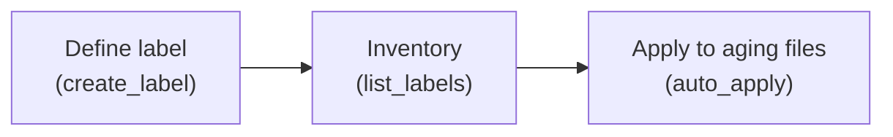

# Records management

A retention label says **when** retention starts, **how long** it lasts, and
**what happens** at the end. Labels are defined once in the tenant, then applied
to content by users or by auto-apply policies. This folder is the label
lifecycle — define, inventory, apply.



!!! warning "Delegated-only + admin role"
    Records management does not support app-only access and needs the
    **Compliance Administrator** (or Global Administrator) role. Both examples
    therefore use `with_token_interactive` and a `require_role` pre-flight guard,
    which exits `1` with a clear message if the role is missing.

## [Create a retention label](create_label.py)

Defines a label that retains content as a record for a set number of days after
it is labeled, then deletes it.

```python
label = client.security.labels.retention_labels.add(
    args.name,
    RetentionTrigger.dateLabeled,
    RetentionDurationInDays(args.days),
    BehaviorDuringRetentionPeriod.retainAsRecord,
    DefaultRecordBehavior.startLocked,
    ActionAfterRetentionPeriod.delete,
).execute_query()
```

```bash
python create_label.py
python create_label.py --name "Retain 7 Years" --days 2555
```

## [List retention labels](list_labels.py)

Inventory of every label, its trigger and end action, and whether it is in use.

```bash
python list_labels.py
python list_labels.py --in-use
```

## [Auto-apply a label to aging files](auto_apply.py)

Walks each site's default document library, finds files older than `--days` that
still carry no label (the "legacy content" gap), and — only with `--apply` —
labels them.

```python
item.retention_label.get().execute_query()
if item.created_datetime < cutoff and not item.retention_label.name:
    item.set_retention_label(label.display_name).execute_query()
```

```bash
python auto_apply.py                          # dry run
python auto_apply.py --apply --limit 50
```

Dry run is the default; it prints exactly which files it would touch.

## See also

- Applying and publishing labels in SharePoint — [`../../sharepoint/compliance/`](../../sharepoint/compliance/)

## Official docs

- [Records management API](https://learn.microsoft.com/en-us/graph/api/resources/security-recordsmanagement-overview)
- [Create a retention label](https://learn.microsoft.com/en-us/graph/api/security-post-retentionlabels)
