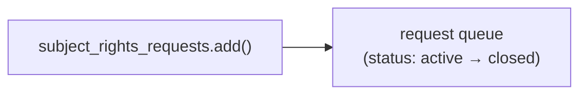

# Subject rights requests

A subject rights request tracks one person's access, export or deletion request
under privacy law (GDPR, CCPA) from intake to fulfilment, including the internal
due date that keeps the organisation inside the statutory window. The Graph
entry point is `client.security.subject_rights_requests`.



## [Create a request](create.py)

Opens a request for a data subject, with a type (`export`, `access`, `delete`)
and an internal due date.

```python
request = client.security.subject_rights_requests.add(
    type="export",
    displayName="...",
    internalDueDateTime="2026-07-05T00:00:00Z",
    dataSubject=DataSubject(email=args.email),
).execute_query()
```

```bash
python create.py
python create.py --email jane@contoso.com --type export --due-days 30
```

## [List requests](list.py)

Reads the request queue with each request's stage — a compliance progress check.

```bash
python list.py
python list.py --status active
```

Both scripts use app-only auth. `create.py` needs
`SubjectRightsRequest.ReadWrite.All`; `list.py` needs
`SubjectRightsRequest.Read.All`. The service must be provisioned for the tenant
otherwise the call reports `HostNotFound`.

## Official docs

- [Subject rights request API](https://learn.microsoft.com/en-us/graph/api/resources/security-subjectrightsrequest)
- [Create a subject rights request](https://learn.microsoft.com/en-us/graph/api/security-post-subjectrightsrequests)
