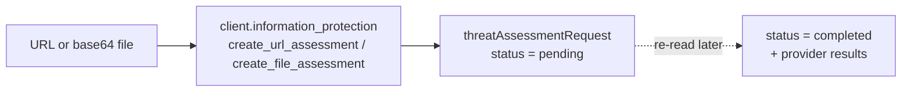

# Threat assessment

Purview can score a URL or a file for spam, phishing and malware — the same
engine that powers Microsoft Defender for Office 365 detonations, exposed
through the Graph **Information Protection** API (`/informationProtection/threatAssessmentRequests`).



## [Scan a URL and a file](scan_url.py)

Submits one URL (default: a known phishing test domain) and one EICAR file, then
prints the request ids and their initial `pending` status.

```python
url_result = client.information_protection.create_url_assessment(
    url=args.url, expected_assessment=args.expected, category=args.category
).execute_query()
print(url_result.url, "->", url_result.status)
```

```bash
python scan_url.py
python scan_url.py --url http://test-phishing-example.com --category phishing
python scan_url.py --no-file
```

Requires the **delegated** permission `ThreatAssessment.ReadWrite.All`
(application permission works too, with the same name). Submission is
asynchronous, so the first read is always `pending`; poll the request by id to
get the verdict.

!!! note "Why this one runs headless"
    Unlike the rest of the Purview examples, threat assessment is reachable with
    a plain user token, so it is the one script in this folder that is verified
    against a live tenant. The others are gated by a Compliance Administrator
    role or by application permissions that are not universally granted.

## Official docs

- [informationProtection: threatAssessmentRequest](https://learn.microsoft.com/en-us/graph/api/resources/threatassessment-api-overview)
- [Create a URL assessment](https://learn.microsoft.com/en-us/graph/api/informationprotection-post-threatassessmentrequests)
