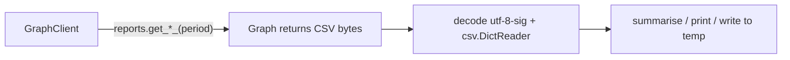

# Microsoft 365 Reports

Usage and adoption reporting across the Microsoft 365 workloads: email and
mailboxes, OneDrive and SharePoint, Teams, Microsoft 365 apps and Office
activations, MFA coverage, and Copilot.

Every report comes from the Microsoft Graph **reports API**. Some endpoints return
a JSON metadata object, but the usage numbers always arrive as **CSV bytes** that
the scripts download, parse, and summarise.

---

## How a usage report works



One call, one CSV. The pattern below is the whole idea; each example wraps it
around a specific report:

```python
def _rows(result) -> list[dict]:
    value = result.value
    text = value.decode("utf-8-sig") if isinstance(value, bytes) else (value.content or b"").decode("utf-8-sig")
    return list(csv.DictReader(io.StringIO(text)))


rows = _rows(client.reports.get_email_activity_counts("D30").execute_query())
for row in rows:
    print(f"{row['Report Date'][:10]}  sent={row['Send']}  read={row['Read']}")
```

!!! note "Decode with `utf-8-sig`, not `utf-8`"
    Graph prefixes the CSV with a UTF-8 BOM. Decoding with plain `utf-8` leaves the
    first column named `"\ufeffReport Date"`, so every lookup silently returns
    `None`. Use `utf-8-sig`.

---

## Start here

### [Quickstart — tenant snapshot](quickstart.py)

Mail volume, mailbox count, OneDrive files and storage, and Teams in one pass —
the fastest way to confirm `Reports.Read.All` works and to get a feel for a tenant.

```python
email = client.reports.get_email_activity_counts("D7").execute_query()
print(_rows(email)[-1])  # latest day: Send / Receive / Read
```

### [Any report](usage_reports.py)

A generic explorer over all report methods: `--list` to discover, `--report` and
`--period` to fetch, `--csv` to save the raw CSV (defaults to the temp directory).

```python
rows = _rows(client.reports.get_sharepoint_activity_user_detail("D30").execute_query())
```

### [Export several reports concurrently](export_usage_async.py)

`reports.download_report_async()` streams each CSV, so independent reports overlap.
The download endpoint throttles aggressively, so the script caps concurrency and
retries on `429` with `Retry-After`.

```python
result = await client.reports.download_report_async(name, out_dir / f"{name}.csv", period)
```

---

## The reports, by workload

| Folder | What it answers |
| --- | --- |
| [mail](mail/README.md) | How much mail flows, how big mailboxes are, who is near quota |
| [files](files/README.md) | Who uses OneDrive/SharePoint, and where the storage lives |
| [teams](teams/README.md) | How many teams exist and how active they are |
| [apps](apps/README.md) | Which Microsoft 365 apps are used, and Office activation gaps |
| [security](security/README.md) | MFA / SSPR coverage, and admins without MFA |
| [copilot](copilot/README.md) | Copilot license adoption and usage |

---

## Periods and permissions

Period-based reports take an aggregation window — `D7`, `D30`, `D90`, or `D180`
and the scripts default to `D30` (the quickstart uses `D7`). All of them need the
**`Reports.Read.All`** application permission; the MFA report additionally accepts
`AuditLog.Read.All`.

## Official docs

- [Microsoft Graph reports API overview](https://learn.microsoft.com/en-us/graph/api/resources/report)
- [MFA registration details API](https://learn.microsoft.com/en-us/graph/api/authenticationmethods-list-userregistrationdetails)
