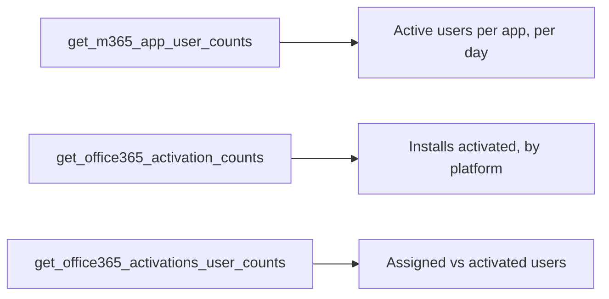

# App & activation reports

Which Microsoft 365 apps people use, and where Office licenses are assigned but
not activated.



## [Microsoft 365 apps](m365_apps.py)

Active users per application (Outlook, Word, Excel, PowerPoint, OneNote, Teams,
and Copilot when licensed) for the latest day, with the peak over the period.

```python
rows = _rows(client.reports.get_m365_app_user_counts("D30").execute_query())
apps = [c for c in rows[0] if c not in ("Report Refresh Date", "Report Period", "Report Date")]
```

## [Office activations](activations.py)

Activated Office installs per product and platform, and the assigned-vs-activated
gap per product — the reclaimable-license signal.

```python
counts = _rows(client.reports.get_office365_activation_counts().execute_query())
users = _rows(client.reports.get_office365_activations_user_counts().execute_query())
```

`get_office365_activation_counts()` takes **no period**; the activation reports
are snapshots. Tenants without Office installs return no rows and the script says
so.

Both scripts need the **`Reports.Read.All`** application permission.
