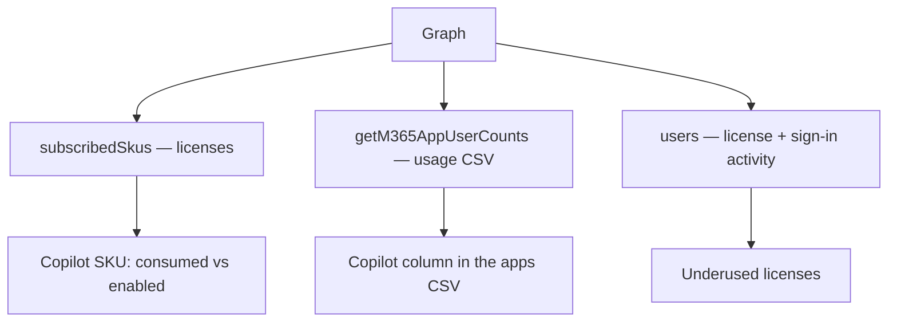

# Microsoft 365 Copilot

Copilot admin reporting: license adoption, usage, and license reclamation. Copilot
has no reports endpoint of its own — it appears through the subscription, apps
usage, and user sign-in data.



## [License adoption](license_report.py)

Which Copilot SKUs are subscribed, and how many licenses are consumed vs enabled.
Match on a `--keyword` (default `COPILOT`) against the SKU part number.

```python
for sku in client.subscribed_skus.get().execute_query():
    if "COPILOT" in (sku.sku_part_number or "").upper():
        enabled = sku.prepaid_units.enabled if sku.prepaid_units else 0
        print(sku.sku_part_number, sku.consumed_units, "/", enabled)
```

## [Usage](usage_report.py)

Copilot activity from the Microsoft 365 apps usage report. When Copilot is
licensed, `getM365AppUserCounts` gains a `Copilot` column; the script isolates it
and prints active users per day. Without Copilot licenses there is no column, and
the script says so.

```python
rows = client.reports.get_m365_app_user_counts("D30").execute_query().csv_rows()
copilot_columns = [c for c in rows[0] if "copilot" in c.lower()]
```

## [Underused licenses](underused_licenses.py)

Users holding a Copilot license with no recent sign-in — candidates for license
reclamation. Reading `signInActivity` needs `AuditLog.Read.All`; without it the
script prints the hint and exits cleanly.

```python
users = client.users.select(["userPrincipalName", "assignedLicenses", "signInActivity"]).get().execute_query()
licensed = [u for u in users if any(lic.skuId in sku_ids for lic in (u.assigned_licenses or []))]
```

---

Not yet covered by the library: Copilot admin settings and the AI-interaction
audit log are exposed by Graph but have no SDK models yet.
