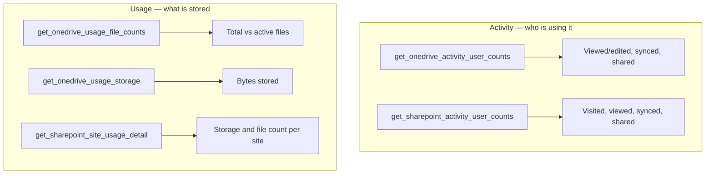

# File reports — OneDrive and SharePoint

Who is using OneDrive and SharePoint, and where the storage actually lives.



## [OneDrive activity](onedrive_activity.py)

Unique users who viewed or edited, synced, or shared files each day — split into
internal and external sharing, with peak and total per activity type.

```python
rows = _rows(client.reports.get_onedrive_activity_user_counts("D30").execute_query())
for row in rows:
    print(row["Report Date"][:10], row["Viewed Or Edited"], row["Shared Externally"])
```

## [OneDrive usage](onedrive_usage.py)

Total vs active files, and the daily storage trend. The storage report returns
one row per site type; the script keeps the `OneDrive` rows.

```python
files = _rows(client.reports.get_onedrive_usage_file_counts("D30").execute_query())
storage = _rows(client.reports.get_onedrive_usage_storage("D30").execute_query())
```

## [SharePoint sites](sharepoint_sites.py)

Per-site storage and file counts for the whole tenant, listing the largest sites
by default — the basis for SharePoint storage governance and cleanup.

```python
rows = _rows(client.reports.get_sharepoint_site_usage_detail("D30").execute_query())
total = sum(float(r.get("Storage Used (Byte)") or 0) for r in rows)
```

!!! note "Concealed site names"
    When a tenant enables report privacy, the report hides site URLs and owner
    names behind placeholders. `sharepoint_sites.py` detects that and falls back
    to the site template (`Group`, `Team Site`, ...) plus the file count.

All three scripts need the **`Reports.Read.All`** application permission.
