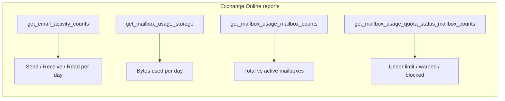

# Mail reports

Exchange Online usage: how much mail flows, how big the mailboxes are, and how
close they are to their quotas. All three come from the Graph reports API as CSV.



## [Email activity](activity.py)

Sent, received, and read counts per day, with period totals — spot usage trends
and justify (or reclaim) mail licensing.

```python
rows = client.reports.get_email_activity_counts("D30").execute_query().csv_rows()
for row in rows:
    print(row["Report Date"][:10], row["Send"], row["Receive"], row["Read"])
```

## [Mailbox usage](mailbox_usage.py)

Mailbox storage trend, total vs active mailbox counts, and the quota-status
breakdown (under limit, warning issued, send prohibited, send/receive
prohibited, indeterminate) — the input for storage planning.

```python
storage = client.reports.get_mailbox_usage_storage("D30").execute_query().csv_rows()
quota = client.reports.get_mailbox_usage_quota_status_mailbox_counts("D30").execute_query().csv_rows()
```

Both scripts need the **`Reports.Read.All`** application permission.
