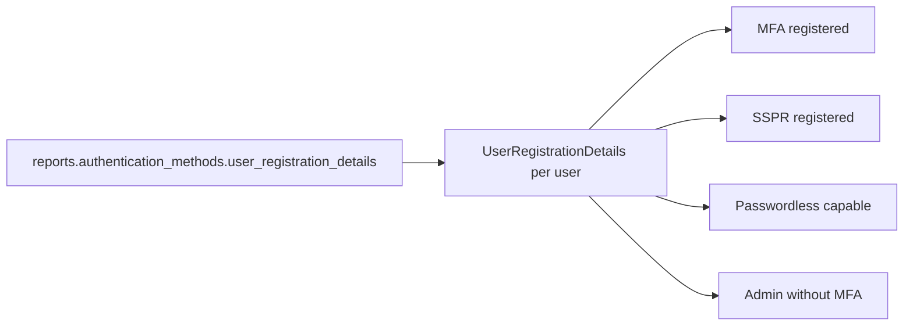

# Security reports

Identity-security coverage from the Graph reports API. The registration report is
not a CSV: it returns a JSON collection of `UserRegistrationDetails`, one entry
per user, that you query directly.



## [MFA status](mfa_status.py)

Tenant-wide MFA / SSPR / passwordless coverage, the count of admins without MFA,
and a listing of users who have not registered MFA (or all users with `--all`).

```python
details = client.reports.authentication_methods.user_registration_details.get().execute_query()
without_mfa = [d for d in details if not d.is_mfa_registered]
```

Use `--admins-only` to focus on privileged accounts — the highest-value gap.

Needs **`Reports.Read.All`** (or **`AuditLog.Read.All`**).
