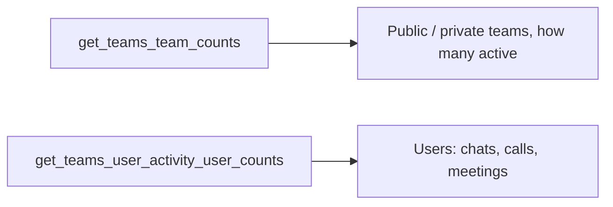

# Teams reports

How many teams exist and how much they are used. Both come from the Graph
reports API and are useful for a Teams governance or cleanup exercise.



## [Teams usage](usage.py)

Team counts by visibility with the active-vs-total split, plus unique users per
activity type (team chat messages, private chat messages, calls, meetings).

```python
teams = _rows(client.reports.get_teams_team_counts("D30").execute_query())
users = _rows(client.reports.get_teams_user_activity_user_counts("D30").execute_query())
```

A period with no Teams activity is normal in a small tenant; the script prints
that instead of an empty table.

Needs the **`Reports.Read.All`** application permission.
