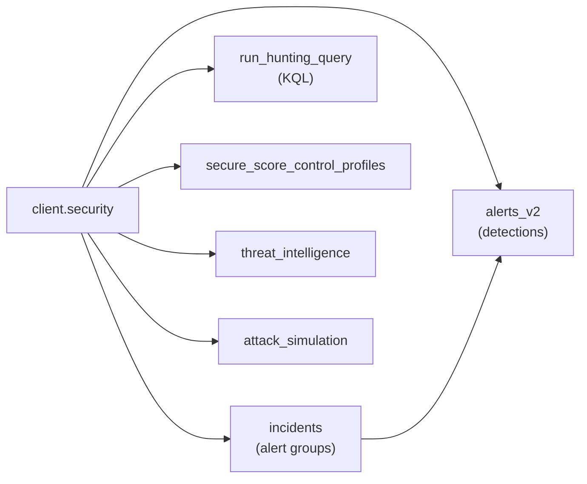

# Working with the Security API (Microsoft Defender XDR)

Microsoft Graph exposes one **Security API** — the `/security` endpoint
(`client.security`) — and **Microsoft Defender XDR** is its main product:
incidents, alerts and advanced hunting. The same endpoint also carries
**Microsoft Secure Score**, **Defender Threat Intelligence**, attack-simulation
training, and — used by [Purview](../purview/) — eDiscovery, cases, retention
labels and subject-rights requests.

So "Defender" is *what you buy*; `client.security` is *what you call*. This
folder is the guided tour of that endpoint; every script runs against your tenant
and (mostly) only reads, so it's safe to try.

## The model in one picture



An **incident** groups related **alerts**; alerts carry **evidence** (devices,
users, files, processes). Hunting queries read the raw tables those detections
were built from.

## Start here

```bash
cp .env.example .env
uv run python examples/security/incidents.py
```

## Alerts — the detections

`alerts_v2` is the current alert API (alerts and their evidence in one shape).
List them, filter by status, then triage by setting classification and status.

```python
alerts = client.security.alerts_v2.top(20).get().execute_query()

alert = client.security.alerts_v2[alert_id].get().execute_query()
alert.set_property("classification", "truePositive")
alert.set_property("status", "resolved")
alert.update().execute_query()
```

→ [`alerts.py`](./alerts.py) (list/filter) · [`alerts_triage.py`](./alerts_triage.py) (classify & resolve)

## Incidents — grouped investigations

```python
incidents = client.security.incidents.filter("status eq 'active'").get().execute_query()
incident = client.security.incidents[incident_id].expand(["alerts"]).get().execute_query()
```

→ [`incidents.py`](./incidents.py) · [`incident_details.py`](./incident_details.py) (alerts expanded)
· [`update_incident.py`](./update_incident.py) (status, classification, assignment)
· [`incident_attack_story.py`](./incident_attack_story.py) (summarize the evidence)

## Advanced hunting — ask your own questions

```python
result = client.security.run_hunting_query(
    "DeviceProcessEvents | where FileName == 'powershell.exe' | take 50"
).execute_query()
```

→ [`hunting.py`](./hunting.py)

## Secure Score — posture & improvements

```python
profiles = client.security.secure_score_control_profiles.get().execute_query()
```

→ [`secure_score.py`](./secure_score.py)

## Threat intelligence — enrich an indicator

```python
ti = client.security.threat_intelligence
host = ti.hosts["contoso.com"].get().execute_query()
print(host.properties.get("firstSeenDateTime"), ti.intel_profiles.get().execute_query())
```

→ [`threat_intelligence.py`](./threat_intelligence.py)

## Attack simulation — phishing & training

```python
sim = client.security.attack_simulation
for campaign in sim.simulations.get().execute_query():
    print(campaign.properties.get("displayName"), campaign.properties.get("status"))
```

→ [`attack_simulation.py`](./attack_simulation.py)

## Permissions

Pick the narrowest that works; security scopes need **admin consent**.

| Permission | Grants |
|---|---|
| `SecurityAlert.Read.All` / `.ReadWrite.All` | Read / triage alerts |
| `SecurityIncident.Read.All` / `.ReadWrite.All` | Read / update incidents |
| `ThreatHunting.Read.All` | Run advanced hunting queries |
| `SecurityEvents.Read.All` | Secure Score control profiles |
| `ThreatIntelligence.Read.All` | Threat-intelligence indicators |
| `AttackSimulation.Read.All` | Attack-simulation campaigns |

## Related

| Folder | What it covers |
|---|---|
| [`../purview/`](../purview/) | eDiscovery, records, retention labels, subject rights (also `client.security.*`) |
| [`../entraid/audit/`](../entraid/audit/) | Directory audit and sign-in logs |

## Official docs

- [Security API overview](https://learn.microsoft.com/en-us/graph/api/resources/security-api-overview)
- [Alert](https://learn.microsoft.com/en-us/graph/api/resources/security-alert) · [Incident](https://learn.microsoft.com/en-us/graph/api/resources/security-incident)
- [Advanced hunting](https://learn.microsoft.com/en-us/graph/api/security-security-runhuntingquery) · [Secure Score](https://learn.microsoft.com/en-us/graph/api/resources/securescores) · [Attack simulation](https://learn.microsoft.com/en-us/graph/api/resources/attacksimulationroot)
