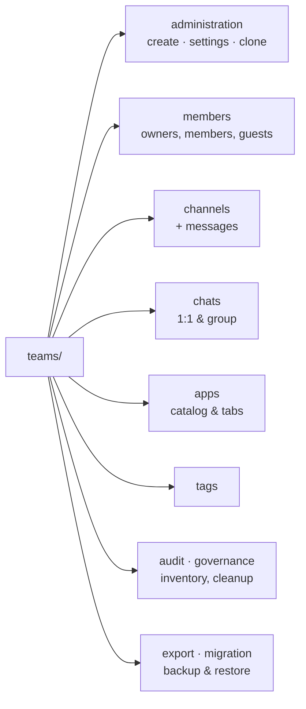

# Microsoft Teams

`client.teams` is Microsoft Graph's **Teams** API: teams, channels, channel
messages, team members, installed apps, tags — plus the team-scoped operations
that only make sense next to a team. This folder is organised **by resource**,
so each subfolder answers one question.

> Teams is the one product where creation is **asynchronous**. Creating (or
> cloning) a team returns a `teamsAsyncOperation`; shared and private channel
> creation is also accepted with `202 Accepted` and polled. The library wraps
> this in `create_and_wait` / `clone_and_wait`, and `ChannelCollection.add`
> polls the operation for you. See [Async & long-running operations](#async-long-running-operations).

## The model



## Start here

```bash
cp .env.example .env
uv run python examples/teams/quickstart.py            # list teams
uv run python examples/teams/quickstart.py --create   # create + delete a team
```

→ [`quickstart.py`](./quickstart.py) connects, lists the tenant's teams, and
shows the one asynchronous call (`create_and_wait`). If it prints teams, your
consent is fine.

## The basics — one team

[`administration/`](./administration/) · `Team.Create`, `TeamSettings.ReadWrite.All`, `Directory.ReadWrite.All`

The core lifecycle: create, rename, change settings, archive and delete. Team
creation is async, so `create_and_wait()` submits the operation, polls it and
returns the provisioned team from a single `execute_query()`.

```python
team = client.teams.create_and_wait(
    display_name="Finance",
    description="Budgeting and reporting",
    owners=["owner@contoso.com"],  # required for app-only creation
).execute_query()
print(team.id, team.display_name)
```

| Script | What it does |
|---|---|
| [`administration/lifecycle.py`](./administration/lifecycle.py) | `create` · `update` · `settings` · `archive` · `unarchive` · `delete` |
| [`administration/clone.py`](./administration/clone.py) | Clone a team and wait for the copy (`clone_and_wait`) |
| [`administration/settings_audit.py`](./administration/settings_audit.py) | Compare every team's settings against a policy baseline |

## Membership

[`members/`](./members/) · `TeamMember.Read.All` · `TeamMember.ReadWrite.All`

Team members are `ConversationMember` entities with a `roles` list. Adding an
owner means sending a member with `roles: ["owner"]`; the library builds that
payload for you.

```python
team.members.add(user, roles=["owner"]).execute_query()
for member in team.members.get().execute_query():
    print(member.display_name, member.email, list(member.roles or []))
```

| Script | What it does |
|---|---|
| [`members/lifecycle.py`](./members/lifecycle.py) | `list` · `add` · `set-role` · `remove` |
| [`members/guest_audit.py`](./members/guest_audit.py) | Teams with external guests (`#EXT#`) |
| [`members/audit.py`](./members/audit.py) | Orphaned teams (no owner) and over-owned teams |

## Channels

[`channels/`](./channels/) · `Channel.ReadBasic.All` · `Channel.Create` · `ChannelMessage.Read.All`

A team owns channels; the **General** channel is the primary one and cannot be
deleted. Channel membership type (`standard`, `private`, `shared`) is fixed at
creation. Shared channels are shared with other teams rather than adding everyone
as a guest — see [`channels/shared.py`](./channels/shared.py).

```python
channel = team.channels.add("Project Falcon", description="Delivery").execute_query()
messages = channel.messages.get_all().top(20).execute_query()
```

| Script | What it does |
|---|---|
| [`channels/lifecycle.py`](./channels/lifecycle.py) | `list` · `create` · `update` · `delete` · `primary` · channel email |
| [`channels/messages.py`](./channels/messages.py) | `send` · `reply` · `list` · per-channel activity digest |
| [`channels/inventory.py`](./channels/inventory.py) | Cross-team channel inventory (flags private/shared) |
| [`channels/inactive.py`](./channels/inactive.py) | Channels that have gone quiet |
| [`channels/shared.py`](./channels/shared.py) | Shared channels: create, share with another team, check access |

## Chats

[`chats/`](./chats/) · `Chat.ReadWrite.All` (application) · `Chat.ReadWrite` (delegated)

Chats are **not** under a team: they are first-class, user-relative resources
(`client.users[...].chats`). One-on-one and group chats have messages, members
and a topic, but no channels and no threaded replies.

| Script | What it does |
|---|---|
| [`chats/inventory.py`](./chats/inventory.py) | A user's chats, by type, with last activity |
| [`chats/lifecycle.py`](./chats/lifecycle.py) | `create-one-on-one` · `create-group` · `members` · `add-member` · `delete` |
| [`chats/messages.py`](./chats/messages.py) | `send` · `list` · `export` · activity digest |

## Apps & tabs

[`apps/`](./apps/) · `TeamsAppInstallation.Read.All` · `AppCatalog.Read.All` · `Tab.Read.All`

The **app catalog** is the tenant store (built-in, store, sideloaded). An
**installation** is an app added to a team. A **tab** is a pinned app in a
channel — the same app surfaced in the UI.

| Script | What it does |
|---|---|
| [`apps/catalog.py`](./apps/catalog.py) | Inventory of the tenant app catalog |
| [`apps/installed.py`](./apps/installed.py) | App adoption across all teams (shadow-IT detection) |
| [`apps/lifecycle.py`](./apps/lifecycle.py) | `search` · `list` · `install` · `uninstall` |
| [`apps/tabs.py`](./apps/tabs.py) | Tabs (pinned apps) across teams → channels |

## Tags

[`tags/`](./tags/) · `TeamworkTag.Read.All` · `TeamworkTag.ReadWrite.All`

A **tag** is a named group of members ("Designers") that can be `@mentioned` in
a channel, so tagging is a per-team membership feature rather than a directory
object.

| Script | What it does |
|---|---|
| [`tags/lifecycle.py`](./tags/lifecycle.py) | `create` · `list` · `assign` · `unassign` · `members` · `delete` |
| [`tags/report.py`](./tags/report.py) | All tags across teams + teams without tags |

## Audit & governance

[`audit/`](./audit/) · [`governance/`](./governance/)

Read-only reports for ownership, guests, settings drift, empty/inactive teams
and soft-deleted groups. Anything destructive is a **dry run by default** and
only changes state with `--apply`.

| Script | What it does |
|---|---|
| [`audit/inventory.py`](./audit/inventory.py) | Tenant-wide inventory with membership breakdown |
| [`audit/empty.py`](./audit/empty.py) | Teams with no channels, and channels that are silent |
| [`audit/lifecycle.py`](./audit/lifecycle.py) | Archived teams and recently deleted (restorable) groups |
| [`governance/inactive.py`](./governance/inactive.py) | `report` / `archive` / `delete` teams idle ≥ `--days` |
| [`governance/restore.py`](./governance/restore.py) | List, restore, or purge a soft-deleted group |

## Export, import & migration

[`export/`](./export/) · [`migration/`](./migration/)

`export/` writes the tenant inventory as CSV/JSON and provisions teams from CSV.
`migration/` is the heavier toolkit: a resumable `MigrationJob` that archives a
team's structure, members, channels, tabs, apps, messages and (optionally) files
into a portable folder.

| Script | What it does |
|---|---|
| [`export/inventory.py`](./export/inventory.py) | Export tenant inventory to CSV + JSON |
| [`export/memberships.py`](./export/memberships.py) | One row per team member (`team,name,email,roles`) |
| [`export/provision.py`](./export/provision.py) | Bulk-provision teams from CSV (`--dry-run`) |
| [`migration/migrate/export_team.py`](./migration/migrate/export_team.py) | Resumable team archive via `MigrationJob` (see [`migration/README.md`](./migration/README.md)) |
| [`migration/migrate/export_messages.py`](./migration/migrate/export_messages.py) | Compliance message export (`to_ndjson` + hosted contents) |

## Usage reports & async patterns

Teams usage analytics live with the rest of the reporting endpoints, and the
reusable asynchronous patterns live under `patterns/`:

- [`../reports/teams/usage.py`](../reports/teams/usage.py) — team counts and user activity over periods
- [`../reports/usage_reports.py`](../reports/usage_reports.py) — the wider Graph reporting surface
- [`../patterns/async/provision_teams_async.py`](../patterns/async/provision_teams_async.py) — provision many teams concurrently
- [`../patterns/lro/wait_team_clone_async.py`](../patterns/lro/wait_team_clone_async.py) — clone a team without blocking the loop

## Async & long-running operations

Two Teams operations are **not** synchronous, and the library hides the polling
behind `*_wait` helpers:

| Operation | Synchronous helper | Explicit form |
|---|---|---|
| Create a team | `client.teams.create_and_wait(...)` | `create(...)` → poll the `TeamsAsyncOperation` |
| Clone a team | `team.clone_and_wait(...)` | `team.clone(...)` → `poll_for_status()` |
| Create a private/shared channel | `channel = team.channels.add(..., membership_type="shared")` | polls the `202` operation inside `add()` |

The explicit, awaitable versions are in
[`../patterns/lro/`](../patterns/lro/) (async twin of
[`administration/clone.py`](./administration/clone.py)). App-only team creation
should pass `owners=[...]` — Graph rejects an owner-less team in application
context.

## Permissions at a glance

| Area | Application | Delegated |
|---|---|---|
| Read teams / channels | `Team.ReadBasic.All`, `Channel.ReadBasic.All` | same |
| Create / rename / delete | `Group.ReadWrite.All`, `Team.Create` | `Team.Create` |
| Settings & archive | `TeamSettings.ReadWrite.All` | same |
| Members | `TeamMember.Read.All` / `ReadWrite.All` | same |
| Channel messages | `ChannelMessage.Read.All`; send needs `ChannelMessage.Send.All` | read needs `ChannelMessage.Read.All`, send `ChannelMessage.ReadWrite` |
| Chats | `Chat.Read.All` / `Chat.ReadWrite.All` | `Chat.Read` / `Chat.ReadWrite` |
| Apps & tabs | `TeamsAppInstallation.Read.All`, `AppCatalog.Read.All` | same |
| Tags | `TeamworkTag.Read.All` / `ReadWrite.All` | same |

The example scripts read credentials and the test account from `tests/settings`
(via `.env`). Where a permission is missing they print the missing scope and
exit cleanly rather than crashing.

## Related tours

Online meetings, presence and call records look like Teams features but belong to
Graph's **cloud communications** namespace, so they have their own tour:
[`../communications/`](../communications/). The reporting endpoints live in
[`../reports/`](../reports/).

## Official docs

- [Microsoft Teams API overview](https://learn.microsoft.com/en-us/graph/api/resources/teams-api-overview)
- [List teams](https://learn.microsoft.com/en-us/graph/api/team-list)
- [Create team](https://learn.microsoft.com/en-us/graph/api/team-post)
- [teamsAsyncOperation](https://learn.microsoft.com/en-us/graph/api/resources/teamsasyncoperation)
