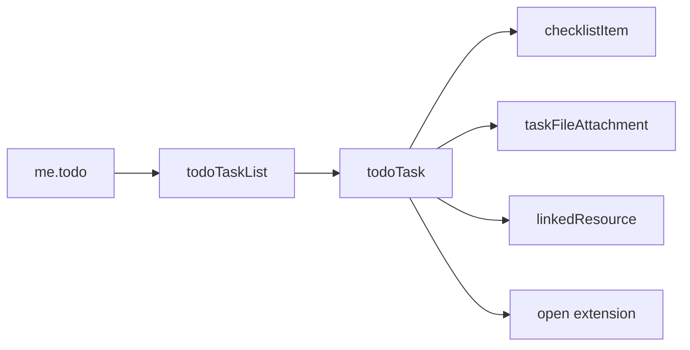

# Microsoft To Do

Tasks, checklists, reminders, and recurring to-dos for the signed-in user.
Microsoft To Do is exposed through Microsoft Graph at `/me/todo`, and this
folder shows how to drive it end to end with the library.

---

## How To Do maps to the API



A **task list** (`todoTaskList`) holds **tasks** (`todoTask`). Each task can carry
a body, importance, start due dates, categories, a reminder, a recurrence, a
checklist of **subtasks** (`checklistItem`), **file attachments**, **linked
resources** (the email or chat it came from), and **open extensions** for custom
data.

The whole API hangs off the signed-in user:

```python
task_list = client.me.todo.lists.ensure("Groceries").execute_query()
task = task_list.tasks.add(
    "Buy milk",
    due_date_time=datetime.now(timezone.utc) + timedelta(days=1),
    importance=Importance.high,
    body="Two litres, semi-skimmed",
).execute_query()
```

!!! note "Addressing a task list"
    `client.me.todo.lists["<id>"]` is lazy, but the list **id** is an opaque
    mailbox-style string. Prefer `lists.ensure(name)` (create-or-get by display
    name) or `lists.filter("displayName eq '…'")`, exactly like the SharePoint and
    OneDrive tours address objects by a natural key.

---

## Start here

### [Quickstart — a task from creation to completion](quickstart.py)

Ensure a list, add a task that is due in two days, break it into checklist
subtasks, complete it, and clean up. The shortest end-to-end path.

```python
task.status = TaskStatus.completed
task.set_property("completedDateTime", DateTimeTimeZone.parse(datetime.now(timezone.utc)))
task.update().execute_query()
```

### [Overview — a dashboard across every list](overview.py)

A read-only pass over all lists reporting open, completed, and overdue counts.

```python
for task_list in client.me.todo.lists.get().execute_query():
    tasks = list(task_list.tasks.get().execute_query())
```

---

## The examples, by area

| Folder | What it answers |
| --- | --- |
| [lists](lists/README.md) | Create, rename, inspect, and delete task lists |
| [tasks](tasks/README.md) | Create rich tasks, update them, search them, add subtasks |
| [attachments](attachments/README.md) | Attach files and link back to source emails or chats |
| [maintenance](maintenance/README.md) | Bulk-remove old completed tasks |

---

## Permissions

Microsoft To Do is a **delegated** API — it acts on the signed-in user's own
lists. The scripts authenticate with the username/password (ROPC) flow and need:

| Scenario | Permission |
| --- | --- |
| Read lists and tasks | `Tasks.Read` |
| Create, update, delete | `Tasks.ReadWrite` |

The examples request `Tasks.ReadWrite`. If it is not granted, a script prints the
missing-permission hint and exits cleanly instead of failing.

!!! note "Inline attachments only"
    Graph accepts simple To Do attachments up to **3 MB**. Upload sessions for
    larger files are not currently supported by the service, so
    [`attachments/file.py`](attachments/file.py) refuses files above that limit.
